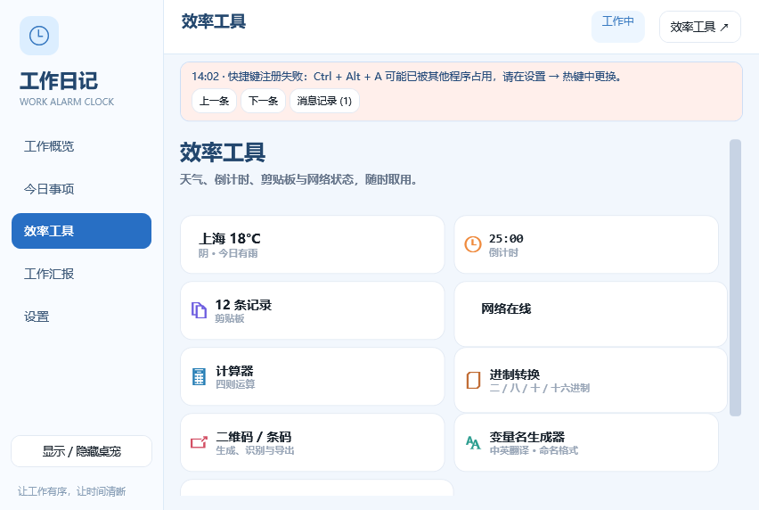
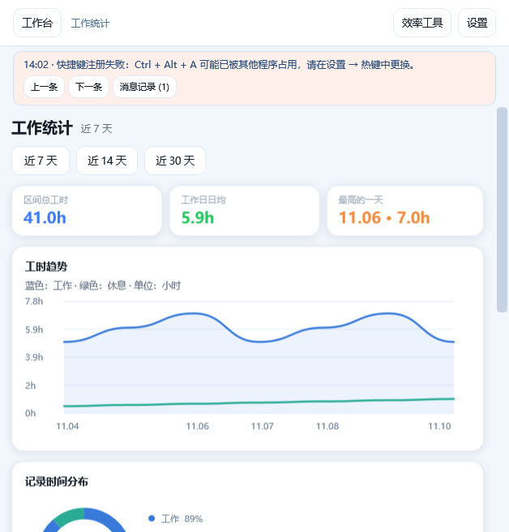

# WorkAlarmClock · 打卡桌宠与效率工作台

面向 Windows 的桌面工作助手：记录工时与事项、提醒下班打卡，并把天气、截图、计算器、二维码等常用工具放进浅蓝色工作台。

[下载最新版](https://github.com/zout7846/WorkAlarmClock/releases/latest) · [更新记录](docs/RELEASES.md) · [操作手册](docs/操作手册.md) · [反馈问题](https://github.com/zout7846/WorkAlarmClock/issues)

## 下载与安装

当前版本：**v3.0.0**。支持 Windows 10 / Windows 11，64 位。

| 文件 | 用途 |
| --- | --- |
| `WorkAlarmClock-3.0.0-Setup-x64.exe` | 安装向导、开始菜单、可选桌面快捷方式及卸载入口 |
| `WorkAlarmClock-3.0.0-Portable-win-x64.zip` | 解压整个目录后运行 `WorkAlarmClock.exe` |
| `SHA256SUMS.txt` | 安装包与便携包的 SHA-256 校验值 |

两个版本均自带 **.NET 10 Windows 桌面运行时**，无需另外安装 .NET。便携版需保留解压后的完整目录，不要只移动 exe。

升级前请从托盘退出旧版，然后运行新安装包。卸载和升级不会主动删除 `%LOCALAPPDATA%\WorkAlarmClock` 中的个人数据；换电脑前可复制该目录备份。

## 功能

- **工时与日报**：按工作日和作息自动计时，区分工作、休息、午休；记录今日事项，生成日报、周报并导出 CSV。
- **桌宠与灵动岛**：拖动、缩放、更换形象，展示工作状态与设备活动；支持托盘和全局热键。
- **网页工作台**：左侧主导航、卡片式工具入口；工具保持独立窗口，顶部可返回工作台或打开设置。
- **提醒与专注**：下班提醒、喝水与久坐提醒、番茄钟、倒计时。
- **截图标注**：区域与窗口截图，矩形、箭头、画笔、文字、马赛克，支持复制与保存。
- **天气与网络**：IP 近似定位或手动选城市，逐小时降水趋势；下载、上传、延迟与实时测速曲线。
- **计算器与进制转换**：四则运算、括号、小数，以及二/八/十/十六进制整数互转。
- **二维码与条码**：生成、图片识别、粘贴、复制、导出 PNG；支持 QR、Code 128、EAN-13；尺寸可用 px、mm、cm，设置存入 SQLite。
- **变量名生成器**：中英互译、快捷键唤起、复制粘贴；小驼峰、大驼峰、下划线、短横线、大写下划线五种格式。
- **图片转换器**：PNG/JPG 互转，批量生成不同尺寸 ICO，或合并成一个多帧 ICO；提供原图、尺寸及路径预览。
- **统计与消息**：工时趋势、时间占比环图、每日柱形图；热键冲突及运行时操作错误通过页面消息轮播展示，可查看最近记录。





> 图片为程序实际 WPF 渲染的界面示例，使用演示数据；错误消息用于展示页面内通知。

## 快速开始

1. 启动后双击托盘图标打开工作台。
2. 在左侧“设置”中配置工作日、上下班、午休和提醒。
3. 在“工作概览”开始工作，在“今日事项”记录进展。
4. 在“效率工具”点击卡片，打开对应独立工具窗口。
5. 下班前整理事项并生成工作汇报。关闭主面板会隐藏至托盘；彻底退出请使用托盘菜单。

热键可在“设置 → 热键”修改。注册失败时，消息栏会指出冲突组合键。天气地区不准时，请在天气工具中手动选择城市；IP 定位仅代表网络出口的近似位置。

## 数据与联网

- 工时、事项及设置主要保存在本地 SQLite 数据库：`%LOCALAPPDATA%\WorkAlarmClock\workalarm.db`。
- 日志位于该目录下的 `logs`，截图及日报目录可以在设置中修改。
- 天气、IP 定位、测速和在线翻译需要网络。翻译会将输入文字发送到 MyMemory，失败时尝试 Google Translate；英文命名格式转换可离线使用。
- 剪贴板历史为可选功能，可在设置中关闭或在历史页清空。

## 源码构建

需要 Windows、[.NET 10 SDK](https://dotnet.microsoft.com/download/dotnet/10.0)。

```powershell
dotnet restore WorkAlarmClock.slnx
dotnet build WorkAlarmClock.slnx -c Release --no-restore
dotnet run --project WorkAlarmClock/WorkAlarmClock.csproj
```

项目采用 WPF、WinForms 托盘、SQLite 与 ZXing.Net。`WorkAlarmClock.Admin` 是本地数据库维护工具，源码保留在解决方案中，不包含在普通安装包里。

```text
WorkAlarmClock/             应用源码
WorkAlarmClock.Admin/       本地数据库维护工具
tests/WorkAlarmClock.UiChecks/  Windows 界面与功能验证
packaging/                 Inno Setup 安装脚本
scripts/Build-Release.ps1   可重复运行的发布构建
docs/                      手册、架构与版本记录
artifacts/                 本地构建、验证和发布产物（不提交 Git）
```

## 验证与打包

运行界面及功能验证（请在仓库根目录执行）：

```powershell
dotnet run --project tests/WorkAlarmClock.UiChecks/WorkAlarmClock.UiChecks.csproj -c Release
```

验证包含正常/最小窗口布局、按钮和输入框尺寸、进制键盘、消息历史及热键失败路径、上传仪表数据、统计图数据一致性、截图标注缩放。测试使用隔离数据库；界面渲染与日志写入 `artifacts/ui-checks-*`，不读取个人工时数据。它不替代真实桌面点击、不同显示器环境及联网服务的人工验收。

安装 [Inno Setup 6.7 或更新版本](https://jrsoftware.org/isinfo.php)，然后执行：

```powershell
./scripts/Build-Release.ps1 -InnoCompiler 'C:/Program Files (x86)/Inno Setup 6/ISCC.exe'
```

脚本从项目文件读取版本，发布 Windows x64 自包含程序，检查关键依赖，生成安装包、便携 ZIP 和校验文件到 `artifacts/release/`。发布产物通过 GitHub Releases 分发，源码仓库不再提交重复的 exe/dll 或过期安装包。
