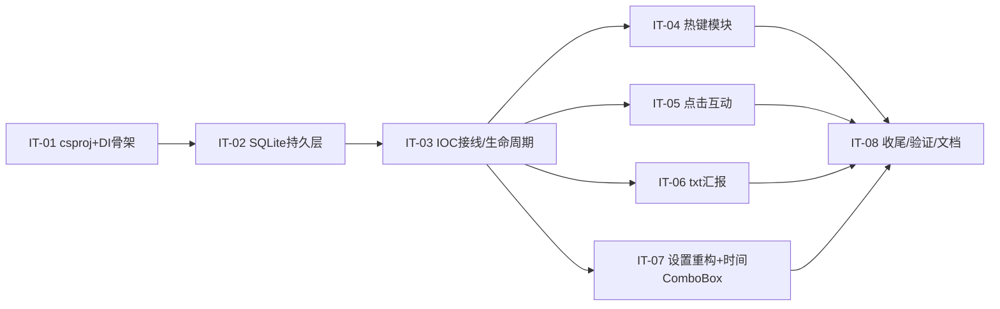

# WorkAlarmClock 工作日记桌宠 — 增量架构设计（ARCHITECTURE-INCREMENT.md）

| 项目信息 | 内容 |
|---|---|
| 文档版本 | v1.1 增量（相对 v1.0 / docs/ARCHITECTURE.md） |
| 上游文档 | docs/PRD.md（v1）、docs/ARCHITECTURE.md（v1 架构）、docs/CHECKLIST.md（v1 验收）、docs/PRD-INCREMENT.md（本增量 PRD） |
| 技术栈 | C# / .NET 10（net10.0-windows）+ WPF + WinForms(NotifyIcon) + **Microsoft.Data.Sqlite** + **Microsoft.Extensions.DependencyInjection** |
| 文档语言 | 简体中文（代码标识符英文） |

> 本增量设计仅描述相对 v1 的**变更**；v1 中未提及的行为（R-01 拖拽贴边、R-02 时钟、R-03 表情、R-05 状态机、R-06 锁屏、R-07 空闲、R-08 手动、R-11 事项、R-15 托盘、R-18 统计、R-20 自启……）**全部沿用 v1 架构与实现**，本文件不重复。

---

## 目录

1. [增量设计决策与取舍（R-22 ~ R-29）](#1-增量设计决策与取舍r-22--r-29)
2. [对 v1 文件的具体修订清单](#2-对-v1-文件的具体修订清单)
3. [有序增量任务列表（IT-01 ~ IT-08）](#3-有序增量任务列表it-01--it-08)
4. [对 v1 文档的同步修订标注](#4-对-v1-文档的同步修订标注)
5. [风险与待明确事项](#5-风险与待明确事项)

---

## 1. 增量设计决策与取舍

### 1.1 R-25 SQLite 替换 JSON（持久层重构）

**核心原则不变**：`ReplayCalculator` 的重算逻辑（时长 = 流水派生）**完全保留**，仅数据源由 `data/YYYY-MM-DD.json` 改为 `state_transitions` 表按时间升序查询（v1 `ReplayCalculator.Replay` 接收 `IReadOnlyList<StateTransition>`，因此 `TimeTrackingService` 在内存中仍持有 `List<StateTransition>`，只是该列表从 SQL 读入而非 JSON）。

**连接策略**：`StorageService` 持有**一个长连接**（`Microsoft.Data.Sqlite.SqliteConnection`，Singleton 生命周期），首启 `PRAGMA journal_mode=WAL` 开启写前日志。所有写操作包在事务（`connection.BeginTransaction()` … `Commit()`）内，保证"强杀进程重启后无重复流水"。

**建表 DDL（幂等）**：

```sql
PRAGMA journal_mode=WAL;

CREATE TABLE IF NOT EXISTS schema_version (
    version INTEGER NOT NULL
);
INSERT OR IGNORE INTO schema_version(version) VALUES (1);

CREATE TABLE IF NOT EXISTS settings (
    key   TEXT PRIMARY KEY,
    value TEXT NOT NULL            -- AppSettings 的 System.Text.Json 序列化
);

CREATE TABLE IF NOT EXISTS day_records (
    date         TEXT PRIMARY KEY,  -- 'YYYY-MM-DD'
    manual_ended INTEGER NOT NULL DEFAULT 0
);

CREATE TABLE IF NOT EXISTS state_transitions (
    id         INTEGER PRIMARY KEY AUTOINCREMENT,
    date       TEXT NOT NULL,
    time       TEXT NOT NULL,       -- ISO8601 "O"，字典序=时间序
    from_state INTEGER NOT NULL,
    to_state   INTEGER NOT NULL,
    source     INTEGER NOT NULL,
    note       TEXT
);
CREATE INDEX IF NOT EXISTS ix_transitions_date_time ON state_transitions(date, time);

CREATE TABLE IF NOT EXISTS work_tasks (
    id        TEXT PRIMARY KEY,     -- Guid 字符串
    date      TEXT NOT NULL,
    timestamp TEXT NOT NULL,
    text      TEXT NOT NULL
);
CREATE INDEX IF NOT EXISTS ix_tasks_date ON work_tasks(date);

CREATE TABLE IF NOT EXISTS report_records (
    id            INTEGER PRIMARY KEY AUTOINCREMENT,
    date          TEXT NOT NULL,
    generated_at  TEXT NOT NULL,
    file_path     TEXT NOT NULL,
    tomorrow_plan TEXT NOT NULL,
    risks         TEXT NOT NULL
);
CREATE INDEX IF NOT EXISTS ix_reports_date ON report_records(date);

CREATE TABLE IF NOT EXISTS reminder_states (
    date                TEXT PRIMARY KEY,
    weak_fired          INTEGER NOT NULL DEFAULT 0,
    weak_ignored        INTEGER NOT NULL DEFAULT 0,
    weak_deferred_until TEXT,
    strong_fired        INTEGER NOT NULL DEFAULT 0,
    strong_confirmed    INTEGER NOT NULL DEFAULT 0,
    strong_repeat_count INTEGER NOT NULL DEFAULT 0
);

-- 迁移标记（与 schema_version 同表族，独立保管）
CREATE TABLE IF NOT EXISTS meta (
    key TEXT PRIMARY KEY,
    value TEXT
);
```

**SaveDay 语义（幂等覆盖）**：每次 `SaveDay(dayRecord)` 在事务内执行 `DELETE FROM state_transitions/work_tasks/report_records WHERE date=@date` 后全量重插当日三张子表 + `UPSERT day_records(manual_ended)`。当日流水 < 200 条，全量替换开销可忽略，且天然避免"追加式"在异常重启后产生重复行。

**旧 JSON → SQLite 一次性迁移**（默认建议自动迁移，见 PRD 待确认 3）：

- `StorageService` 构造/初始化时检查 `meta(key='migration_done')`；若已完成则跳过。
- 否则扫描 `%LOCALAPPDATA%/WorkAlarmClock/data/*.json` 与 `settings.json`：
  - `settings.json` → 反序列化为 `AppSettings`（复用 v1 `JsonOptions`，损坏则跳过并记日志）→ 写入 `settings` 表；
  - 每个 `YYYY-MM-DD.json` → 反序列化为 `DayRecord` → 调 `SaveDay` 写入库；
  - 全部成功后：`File.Move` 旧 `data/*.json` 与 `settings.json` 到 `data_legacy_backup/`（**保留不删除**），置 `migration_done=1`。
- 失败：记 ERROR 日志、保留旧 json 不动、SQLite 以全新库运行。

**ReminderState 持久化（修复 v1 重启重复提醒）**：`reminder_states` 表按 `date` 持久化弱/强提醒触发状态。`ReminderService` 新增依赖 `IStorageService`：`InitializeState(date)` 读当日行、`PersistState(date)` 在 `DeferWeak/IgnoreWeak/AcknowledgeStrong/ResetForNewDay` 时 upsert。AppServices 在 `LoadOrCreateToday` 后调用 `Reminder.InitializeState(today)`；`DayRolled` 时调用 `ResetForNewDay()`（内存态清零 + 数据库行随日期切换自然失效，次日新行默认 0）。**效果**：重启后若当日弱提醒已触发，`weak_fired=1` 被读回，`CheckWeak` 因 `State.WeakFired` 为真不再重复弹。

**DB 损坏恢复**（PRD 待确认 2）：`Open()` 抛 `Microsoft.Data.Sqlite.SqliteException`（含 "malformed"）时，备份 `workalarm.db` 为 `workalarm.db.corrupt`，删除原库，重建空库继续运行。

### 1.2 R-22 全局热键模块

**线程模型（关键）**：`SetWindowsHookEx(WH_KEYBOARD_LL, proc, hMod, 0)` 在主线程（UI 线程，`App.OnStartup` 所在线程）调用，其 `LowLevelKeyboardProc` 回调**即在 UI 线程消息泵中执行**（LL 钩子回调在调用线程上下文运行，WPF Dispatcher 会处理）。因此回调内直接访问 `AppServices` 与执行命令是线程安全的，**无需新建消息循环、无需 Dispatcher.Invoke**。

**P/Invoke 签名**（入 `Infrastructure/NativeMethods.cs`）：

```csharp
private const int WH_KEYBOARD_LL = 13;
private const int WM_KEYDOWN = 0x0100;

[StructLayout(LayoutKind.Sequential)]
internal struct KBDLLHOOKSTRUCT
{
    public uint vkCode;
    public uint scanCode;
    public uint flags;
    public uint time;
    public IntPtr dwExtraInfo;
}

internal delegate IntPtr LowLevelKeyboardProc(int nCode, IntPtr wParam, IntPtr lParam);

[DllImport("user32.dll", SetLastError = true)]
private static extern IntPtr SetWindowsHookEx(int idHook, LowLevelKeyboardProc lpfn, IntPtr hMod, uint dwThreadId);

[DllImport("user32.dll", SetLastError = true)]
[return: MarshalAs(UnmanagedType.Bool)]
private static extern bool UnhookWindowsHookEx(IntPtr hhk);

[DllImport("user32.dll")]
private static extern IntPtr CallNextHookEx(IntPtr hhk, int nCode, IntPtr wParam, IntPtr lParam);

[DllImport("user32.dll")]
[return: MarshalAs(UnmanagedType.Bool)]
private static extern short GetAsyncKeyState(int vKey);
```

**回调逻辑**：`if (nCode == 0 && wParam == WM_KEYDOWN)` → 读 `vkCode`（`Marshal.ReadInt32(lParam)`）；修饰键状态用 `GetAsyncKeyState(VK_LCONTROL/VK_LMENU/VK_LSHIFT ...)` 取当前快照（避免与 WPF `Keyboard.Modifiers` 在钩子上下文的时序差异）；与 5 个绑定（VkCode + 修饰键集合）逐一比较，**命中则触发对应动作**；**始终 `return CallNextHookEx(...)`**（不吞键，不抢占其他程序热键，符合 PRD 待确认 1）。`_proc` 必须存为字段强引用，防止 GC 回收导致回调崩溃。

**服务边界**：`IHotkeyService` 持有 5 绑定 + `IntPtr _hook`，`Install()/Uninstall()` 包在 `IDisposable.Dispose()` 中（`UnhookWindowsHookEx`）。命中动作不直接耦合业务，而是回调一组 `IHotkeyActions`（由 App 提供：`StartWork/StartRest/EndDay/GenerateReport/TogglePet`），App 把动作接到 `MainViewModel` 命令与 `PetWindow` 显隐切换。

**设置绑定模型**：`AppSettings` 新增 `HotkeySettings`（5 个 `HotkeyCombo { int VirtualKeyCode; bool Ctrl; bool Alt; bool Shift; }` 字段，对应 开始工作/开始休息/结束当天/生成汇报/显示隐藏桌宠）。默认值 `Ctrl+Alt+W / R / E / G / S`。JSON 序列化保持（增量字段向后兼容，旧 settings.json 无此字段 → `CreateDefault` 兜底默认值，见 §2 AppSettings 修改）。

**校验**（设置页）：组内 5 个组合键不可互相同；每个至少含一个修饰键；与系统 Win 组合不主动拦截（仅提示）。命中冲突保存时红字提示并禁用保存。

### 1.3 R-26 点击互动 + 移除隐藏（修改 R-01 部分）

- **移除**：检索并删除任何"单击/点击使桌宠隐藏或收缩为不可见"的路径。当前 `PetWindow.xaml.cs` 中单击未实现隐藏（仅有双击开主面板 + 边缘吸附收缩），但为稳妥，IT-05 明确：**`OnPreviewMouseLeftButtonUp` 若未发生拖动，则只触发互动，绝不修改 `Visibility`**；确保 `Visibility.Collapsed`/`Hide()` 仅出现在关闭窗口与（保留的）边缘吸附收缩逻辑中。
- **新增单击互动**：`OnPreviewMouseLeftButtonUp` 判定 `_isDragging==false` 且位移 < 阈值 → 调 `PetAvatarControl.PlayInteractionAsync()`（播放一段跳跃+眨眼 Storyboard）+ `AppServices.Notification.ShowBubble("嗨~", BubbleKind.Info)`。气泡 8 秒淡出（沿用 v1 机制）。
- **保留**：双击 `OnWindowMouseDoubleClick`（位移阈值内）→ `ShowMainPanel()`；边缘吸附收缩（≤30px → CollapseBar 窄条，MouseEnter 展开）；拖动。
- `PetAvatarControl` 新增 "Interaction" VisualState/Storyboard（跳一下 + 眼睛眨），与现有 5 套表情状态并存（互动动画为一次性叠加，不切换主状态）。

### 1.4 R-27 Markdown → 纯 txt（修改 R-12/R-13/R-19）

**接口变更**：`IReportService.RenderMarkdown` → `RenderText(string tomorrowPlan, string risks)`；`Generate` 内部改调 `RenderText`。`ReportRecord.FilePath` 后缀改为 `.txt`（`GetReportPath` 用 `.txt`）。

**固定 6 栏顺序（纯文本，无 Markdown 符号）**：

```
工作和休息时间：工作 Xh Ym / 休息 Xh Ym / 午休 HH:mm–HH:mm
日期：YYYY-MM-DD
工作汇报：
（空行，正文由用户事后补充）

今日工作：
1. HH:mm 事项
2. HH:mm 事项
（无事项 → "无"）

明日计划：
<可编辑内容，默认空>

问题和分析：
<可编辑内容（即原 Risks），默认空>
```

- ① 工作/休息时长取自 `TimeTrackingService.WorkDuration/RestDuration`（经 `TextFormats.DurationToChineseSpaced` 渲染为 "7 小时 42 分钟"），午休段取自 `ReplayCalculator.Replay` 结果新增的 `Lunch` 字段（v1 `ReplayResult` 已含 `Lunch`，直接复用）。
- ④ 事项列表：编号 + `HH:mm` + 文本，空 → "无"。
- ③ 仅 "工作汇报：" 标题 + 空行占位，正文留空（不新增"今日总结"输入框）。
- ⑤⑥ 来自可编辑区（默认 "-" 或空）。
- **不再生成 `.bak`**：同日重复生成直接 `File.WriteAllText` 覆盖。
- **设置模板能力降级**：移除自由占位符模板多行编辑；PRD 待确认 5 默认建议 → `AppSettings` 保留可选 `ReportFooter`（单行页脚文本，默认空），渲染时追加在 ⑥ 之后；`SettingsWindow` 存储页改为单行页脚输入框，删除原模板多行 TextBox。

**预览窗**：`ReportPreviewWindow` 左区 `PreviewText` 本就是只读 `TextBox`，**无需改为 RichText**，仅更新提示文案（去掉 .bak 相关说明）。

### 1.5 R-28/R-24 设置页重构 + 时间 ComboBox

**设置页重写**：`SettingsWindow.xaml` 改为 6 个分组 Tab —— **作息 / 提醒 / 检测 / 外观 / 存储 / 热键**（新增热键分组）。视觉更紧凑（统一 `SectionTitleStyle`、统一间距、滚动容器）。原有全部设置项（透明度滑条、汇报目录浏览、开机自启、声音、空闲阈值、工作日等）保留。

**时间 ComboBox（零依赖自实现）**：新增 `Views/TimeComboBox.xaml(.cs)` 用户控件，暴露 `DependencyProperty SelectedTime (TimeOnly)` 与 `Granularity`（默认 30 分钟）。控件内构建 `ItemsSource`：`for h in 0..23` × `for m in 0..(60 步长-1)` → `TimeOnly(h, m)`，显示串 `HH:mm`（用 `TextFormats.TimeOnlyToHm`）。绑定到 `Draft.WorkStartTime` 等 `TimeOnly` 属性（TwoWay）。**非标值兼容**：载入时若 `Draft` 值落在非档位（如用户曾手填 09:41），控件把该精确值临时加入 `ItemsSource` 以正确回显；保存时按"吸附最近档位"规整（默认建议，见 PRD 待确认 5：吸附到最近 30 分钟档），用户可在设置面板看到吸附后的结果。

**SettingsViewModel 修改**：删除 `WorkStartTimeText` 等 4 个字符串属性与 `TryParseTime`；改为直接绑定 `Draft.WorkStartTime` 等 `TimeOnly`（通过 TimeComboBox 的 `SelectedTime`）；`TryApplyToDraft` 不再解析字符串，直接用 `TimeOnly` 值做区间校验（下班>上班、午休区间合法）；新增热键相关属性 + 组内唯一性校验。

### 1.6 R-29/R-23 IOC 容器（替换 v1 服务定位器）

**约束**：仅 `Microsoft.Data.Sqlite` 与 `Microsoft.Extensions.DependencyInjection` 两个微软官方包；禁止任何社区第三方包；自写 MVVM 基类/矢量桌宠/P/Invoke/WinForms NotifyIcon 维持。

**重构 `AppServices`**：由"静态工厂 + 字段"改为"持有 `IServiceProvider` 的薄门面"：

```csharp
public static class AppServices
{
    private static IServiceProvider? _provider;
    private static IServiceProvider Provider =>
        _provider ?? throw new InvalidOperationException("AppServices 尚未初始化。");

    // 向后兼容的静态属性（VM 代码零改动）
    public static ITicker Ticker => Provider.GetRequiredService<ITicker>();
    public static ISettingsService Settings => Provider.GetRequiredService<ISettingsService>();
    // ... 其余 IXxx 同构

    // 跨切面静态事件（保持 v1 契约）
    public static event EventHandler<BubbleRequest>? BubbleRequested;
    public static event EventHandler<double>? LiveOpacityPreview;

    public static void Initialize()
    {
        ServiceCollection services = new();
        ConfigureServices(services);
        _provider = services.BuildServiceProvider();
        WireEvents();          // 接线 BubbleRequested / LiveOpacityPreview / Ticker.Tick 等
        Provider.GetRequiredService<IIdleMonitorService>().Start();
        Provider.GetRequiredService<IReminderService>().Start();
        Provider.GetRequiredService<ITicker>().Start();
        // ... 首启落位、自启对齐等
    }

    private static void ConfigureServices(ServiceCollection services)
    {
        services.AddSingleton<ITicker, ClockTicker>();   // 保留可注入时钟源
        services.AddSingleton<IStorageService, StorageService>();
        services.AddSingleton<ISettingsService, SettingsService>();
        services.AddSingleton<IScheduleService, ScheduleService>();
        services.AddSingleton<ITimeTrackingService, TimeTrackingService>();
        services.AddSingleton<IIdleMonitorService, IdleMonitorService>();
        services.AddSingleton<IReminderService, ReminderService>();
        services.AddSingleton<IReportService, ReportService>();
        services.AddSingleton<IStatisticsService, StatisticsService>();
        services.AddSingleton<IAutoStartService, AutoStartService>();
        services.AddSingleton<INotificationService, NotificationService>();
        services.AddSingleton<IHotkeyService, HotkeyService>();  // 新增
    }

    public static void Shutdown()
    {
        // 退订 Ticker 事件、IdleMonitor.Stop、Reminder.Stop、Notification.Dispose、Hotkey.Uninstall
        _provider?.Dispose();   // 触发各 Singleton IDisposable.Dispose（逆序）
    }
}
```

**生命周期/内存控制**（PRD R-23 验收 3）：
- 所有服务 `AddSingleton`；`ClockTicker` 单例（全应用唯一计时器，v1 约定不变）。
- **IDisposable 服务**：`StorageService`（关闭 SQLite 连接）、`NotificationService`（NotifyIcon 置不可见 + `Dispose` + `DestroyIcon`）、`IdleMonitorService`（`SystemEvents` 退订、`Stop`）、`ReminderService`（`Ticker.Tick -=`）、`HotkeyService`（`UnhookWindowsHookEx`）、`ClockTicker`（`Stop`）均实现 `IDisposable`；`Provider.Dispose()` 逆序释放。
- **集合有界**：`state_transitions`/`work_tasks` 仅当日数据驻内存；统计 `LoadWeek` 读库即时聚合，不留存。
- **容器不持有 View/ViewModel**：`MainViewModel`（App 静态字段 `new MainViewModel()`）、`PetViewModel`、`SettingsViewModel` 等仍由代码 `new` 创建，不进 DI 容器（与 v1 §9.3 一致）；仅服务进容器。

**对 VM 代码的影响最小化**：VM 中 `AppServices.Settings.Current`、`AppServices.Ticker.Now`、`AppServices.Notification.ShowBubble(...)`、`AppServices.Report.Render...`、`AppServices.Reminder.OnReportGenerated()` 等调用**全部保持不变**（门面属性转发到 Provider）。仅 `AppServices` 内部与 `App.xaml.cs` 的初始化/退出、及各服务构造函数（由容器注入依赖）变化。

**SQLite 连接生命周期**：`StorageService` 单例持有一个 `SqliteConnection`，构造时 `Open()` + WAL；`Dispose()` 时 `Close()`。

---

## 2. 对 v1 文件的具体修订清单

> 标记：N=新建，M=修改。XAML 与 .cs 合并计一行。

| # | 文件 | 动作 | 改什么 |
|---|---|---|---|
| 1 | `WorkAlarmClock.csproj` | M | 新增两个 `<PackageReference>`：`Microsoft.Data.Sqlite` 与 `Microsoft.Extensions.DependencyInjection`；更新注释（R-17' 替换 R-17）；其余保持不变（`UseWPF/UseWindowsForms/Nullable` 等）。 |
| 2 | `Infrastructure/NativeMethods.cs` | M | 追加 §1.2 的键盘钩子 P/Invoke（`SetWindowsHookEx`/`UnhookWindowsHookEx`/`CallNextHookEx`/`GetAsyncKeyState`/`KBDLLHOOKSTRUCT`/`LowLevelKeyboardProc`）。 |
| 3 | `Infrastructure/AppEnvironment.cs` | M | 新增 `DbPath`（=`Path.Combine(RootDirectory,"workalarm.db")`）、`DataLegacyBackupDirectory`；`EnsureDirectories` 一并创建 `data_legacy_backup`。 |
| 4 | `Models/AppSettings.cs` | M | 新增 `HotkeySettings Hotkeys`（5 个 `HotkeyCombo`，默认值 Ctrl+Alt+W/R/E/G/S）；新增 `string ReportFooter`（默认空）；`CreateDefault()` 初始化 `Hotkeys` 默认；`Clone()` 同步复制新增字段。新增 `Models/HotkeySettings.cs`：`HotkeyCombo` 记录类型 + `HotkeyAction` 枚举（StartWork/StartRest/EndDay/GenerateReport/TogglePet）。 |
| 5 | `Models/DayRecord.cs` | 不变 | `ReminderState` 仍保留为内存态类型（供 `ReminderService` 使用），但其持久化改走 `reminder_states` 表，不再纯内存。 |
| 6 | `Services/StorageService.cs` | M（重写） | 丢弃 `File`/`Json` 文件读写，改为 SQLite 实现（§1.1）。实现 `Open/WAL`、`EnsureSchema`、`SaveSettings/LoadSettings`、`SaveDay/LoadDay`、`LoadWeek`、`EnsureArchive`（跨天检查改为日期上下文切换，库内归档）、`MigrateLegacyJson`（一次性迁移+归档）。`JsonOptions` 保留用于 `settings` 表的 value 列。 |
| 7 | `Services/ServiceInterfaces.cs` | M | `IStorageService` 注释更新（SQLite）；`IReportService.RenderMarkdown` → `RenderText`；新增 `IHotkeyService`、`IHotkeyActions`、`HotkeyAction` 已入 Models；`IHotkeyService` 接口：`Install()`/`Uninstall()`/`IDisposable` + 属性 `Bindings`（只读视图）；`INotificationService` 无需改动。 |
| 8 | `Services/ReportService.cs` | M | `RenderMarkdown` → `RenderText`（6 栏纯文本，见 §1.4）；`Generate` 内部调 `RenderText`；`GetReportPath` 改 `.txt`；`DefaultTemplate` 常量删除；`BuildTasksText` 保留（编号+HH:mm）；追加页脚 `ReportFooter`（若非空）。 |
| 9 | `Services/ReminderService.cs` | M | 新增依赖 `IStorageService`；`InitializeState(date)` 读 `reminder_states` 行填充 `State`；`DeferWeak/IgnoreWeak/AcknowledgeStrong/ResetForNewDay` 内调 `PersistState(date)` upsert；`State` 仍 `public ReminderState`（内存+库双写）。 |
| 10 | `Services/AppServices.cs` | M（重写） | 由静态工厂改为"持有 `IServiceProvider` 的门面"（§1.6）；`ConfigureServices` 注册全部 Singleton（含 `IHotkeyService`）；`WireEvents` 保留 v1 事件接线；`Initialize` 中首启落位后调 `Reminder.InitializeState(today)` 并 `DayRolled → Reminder.ResetForNewDay`；`Shutdown` 改为退订+`_provider.Dispose()`；`GenerateReportNow` 内部 `RenderText` 替换 `RenderMarkdown`；`AttachTray` 增加 `togglePet` 回调（供热键复用）。 |
| 11 | `Services/HotkeyService.cs` | N | 实现 `IHotkeyService`：`IntPtr _hook`、`LowLevelKeyboardProc _proc`（字段强引用）；`Install()` 在 UI 线程 `SetWindowsHookEx`；回调读 vkCode+修饰键匹配 5 绑定，命中→`IHotkeyActions` 对应动作；`Uninstall()`/`Dispose()` → `UnhookWindowsHookEx`。读取绑定来自 `ISettingsService.Current.Hotkeys`。 |
| 12 | `Services/SettingsService.cs` | M（小改） | `Load`/`SaveSettings` 改走 `IStorageService`（SQLite）。其余校验逻辑（8 条规则）**完整保留**。 |
| 13 | `Services/TimeTrackingService.cs` | M（小改） | 构造函数改由容器注入依赖（不变签名形式，加 `IStorageService` 已在）；`LoadOrCreateToday`/`RollToNewDay` 内 `LoadDay` 现从 SQL 取（逻辑不变）；`Persist()`→`SaveDay` 走 SQL（事务幂等覆盖）。增加：落位后供 `AppServices` 调 `Reminder.InitializeState`。 |
| 14 | `Services/StatisticsService.cs` | M（小改） | `LoadWeek` 走 SQL（已由 StorageService 实现，调用不变）。 |
| 15 | `Services/ScheduleService.cs` / `ReplayCalculator.cs` / `IdleMonitorService.cs` / `NotificationService.cs` / `AutoStartService.cs` | 不变 | 业务逻辑与接口未变；仅构造函数经容器注入（无需手动改，DI 自动）。`ReplayCalculator` 的 `Lunch` 字段已在 v1 提供。 |
| 16 | `ViewModels/DialogViewModels.cs` | M | `SettingsViewModel`：删除 4 个时间字符串属性+`TryParseTime`，改为绑定 `Draft` 的 `TimeOnly`（经 TimeComboBox）；新增 `Hotkeys` 绑定属性 + 组内唯一性校验；`ReportPreviewViewModel.RefreshPreview` 调 `RenderText` 替换 `RenderMarkdown`；`ResetTemplateCommand` 改为 `ResetFooterCommand`（清空页脚）。 |
| 17 | `ViewModels/MainViewModel.cs` | M（小改） | 新增 `TogglePetCommand`（显隐 `PetWindow`），供托盘菜单与热键共用；其余命令不变。 |
| 18 | `Views/SettingsWindow.xaml` | M（重写） | 6 分组 Tab（作息/提醒/检测/外观/存储/热键）；时间 `TextBox` 替换为 `TimeComboBox`；存储页删除模板多行框、加页脚单行框；新增热键分组（`HotkeyEditor` 5 行）。 |
| 19 | `Views/TimeComboBox.xaml(.cs)` | N | 零依赖时间下拉控件：`SelectedTime (TimeOnly)` + `Granularity`（默认 30）；内部构建 `TimeOnly` 项；非标值回显+吸附逻辑（§1.5）。 |
| 20 | `Views/HotkeyEditor.xaml(.cs)` | N | 单个绑定编辑控件：Ctrl/Alt/Shift 三 CheckBox + Key ComboBox（A–Z/0–9/F1–F12）+ 实时 "Ctrl+Alt+W" 预览；`SelectedCombo (HotkeyCombo)` 依赖属性。5 行复用。 |
| 21 | `PetWindow.xaml` / `PetWindow.xaml.cs` | M | 新增 `OnPreviewMouseLeftButtonUp` 互动分支（单击未拖动→`PetAvatarControl.PlayInteractionAsync()` + `ShowBubble("嗨~")`）；**确认/移除任何隐藏路径**；保留拖动/吸附/双击/右键菜单。`TogglePet`（供热键）由 App 控制 `Show/Hide`。 |
| 22 | `Views/PetAvatarControl.xaml(.cs)` | M | 新增 "Interaction" VisualState/Storyboard（跳跃+眨眼，一次性，不切换主状态）；暴露 `PlayInteractionAsync()`。 |
| 23 | `Views/ReportPreviewWindow.xaml` | M（小改） | 提示文案去掉 ".bak" 相关；左区只读 `TextBox` 不变；标题"工作汇报预览"不变。 |
| 24 | `App.xaml.cs` | M | `OnStartup`：`AppServices.Initialize()` 内部已含容器构建（调用点不变）；构造 `PetWindow` 后提供 `TogglePet` 闭包给 `AppServices.AttachTray`；`OnExit`：调 `AppServices.Shutdown()`（已含 `_provider.Dispose()` + 钩子卸载）。`ShowMainPanel` 不变。 |
| 25 | `docs/ARCHITECTURE.md` / `docs/CHECKLIST.md` | M | 见 §4 同步修订标注。 |

**文件总量**：新增 4 个（HotkeyService、HotkeySettings/ 模型、TimeComboBox、HotkeyEditor），修改约 18 个（XAML+cs 合并计）。仍保持单工程、单窗体集，无第三方 UI 包。

---

## 3. 有序增量任务列表（IT-01 ~ IT-08）

> 每个任务完成标准 = `dotnet build` 0 警告 0 错误 + 对应验收点通过 + `dotnet list package` 仅含两个微软官方包。

### IT-01 csproj + 依赖声明 + DI 基础设施骨架（P0）

**依赖**：无（首个任务）
**涉及文件**：`WorkAlarmClock.csproj`、`Infrastructure/AppEnvironment.cs`、`Services/AppServices.cs`（改写为容器门面骨架：仅 `Initialize`→`ConfigureServices`→`BuildServiceProvider`，暂保留 v1 各服务类型，接线在 IT-03 补全）、`Models/HotkeySettings.cs`（新建：枚举+记录类型）、`Services/ServiceInterfaces.cs`（追加 `IHotkeyService`/`IHotkeyActions` 接口签名与 `HotkeyAction` 枚举）。
**实现要点**：
1. csproj 加 `Microsoft.Data.Sqlite` 与 `Microsoft.Extensions.DependencyInjection` 两个 PackageReference（版本用 SDK 解析的最新稳定版；与 net10.0-windows 兼容）；注释由"零第三方依赖"改为"仅允许两个微软官方轻量包"。
2. AppEnvironment 增加 `DbPath`、`DataLegacyBackupDirectory` 与 `EnsureDirectories` 创建 `data_legacy_backup`。
3. `AppServices` 改写为持有 `IServiceProvider` 的门面（§1.6 代码骨架），`Initialize` 先 `ConfigureServices` → `BuildServiceProvider`，但**本任务暂不接线事件、暂不 Start 各服务**（留 TODO）；确保可编译通过，门面属性转发到 Provider 不报错。
4. 新建 `HotkeySettings.cs`：`HotkeyAction` 枚举、`HotkeyCombo` 记录（VkCode/VkKey 字符串 + Ctrl/Alt/Shift）、`HotkeySettings` 类（5 属性 + 默认 Ctrl+Alt+W/R/E/G/S）。
5. `ServiceInterfaces.cs` 追加 `IHotkeyService`（Install/Uninstall/IDisposable/Bindings）、`IHotkeyActions`（StartWork/StartRest/EndDay/GenerateReport/TogglePet）、`HotkeyAction` 已在 Models；`IReportService` 先预留 `RenderText` 签名（实现放 IT-06）。
**验收**：`dotnet build` 成功；`dotnet list package` 仅含两个微软官方包；应用可启动（即使服务尚未全接线）。

### IT-02 SQLite 持久层（R-25 核心）（P0）

**依赖**：IT-01
**涉及文件**：`Services/StorageService.cs`（重写）、`Models/AppSettings.cs`（加 `Hotkeys`+`ReportFooter` 字段与默认值，配合 IT-04/IT-07 但此处先建字段）、`Services/SettingsService.cs`（改走 StorageService）、`Services/TimeTrackingService.cs`（SaveDay/LoadDay 走 SQL）、`Services/StatisticsService.cs`（LoadWeek 走 SQL）。
**实现要点**：
1. `StorageService`：`Open()`（连接 `DbPath`，`PRAGMA journal_mode=WAL`，`EnsureSchema` 执行 §1.1 DDL）；`SaveSettings/LoadSettings`（`settings` 表 JSON 列，复用 `JsonOptions`）；`LoadDay(date)`（读 `day_records`+`state_transitions` 升序+`work_tasks`+`report_records` 组装 `DayRecord`，无则 null）；`SaveDay`（事务内 `DELETE`+全量 `INSERT`+`UPSERT day_records`，幂等）；`LoadWeek`（周一至今逐日 `LoadDay`）；`EnsureArchive`（日期上下文切换，库内即归档）；`MigrateLegacyJson`（扫描 `data/*.json`+`settings.json`→入库→`File.Move` 到 `data_legacy_backup`→置 `migration_done`）。
2. 保留 `ReplayCalculator` 不变；`TimeTrackingService.LoadOrCreateToday/RollToNewDay` 仅换 `LoadDay` 数据源，流水重算逻辑不动。
3. `SettingsService.Load/SaveSettings` 改为 `IStorageService`（行为一致）。
4. 损坏恢复：`Open` 抛 `SqliteException` → 备份 `.corrupt` + 删库重建。
**验收**：首启自动建表（DB Browser 或 `sqlite3` 可见 7 表 + 索引）；强杀重启当日流水无重复、时长与 v1 JSON 一致；旧 JSON 自动迁移到 `data_legacy_backup/`；`LoadWeek` 统计正确。

### IT-03 IOC 重构接线与生命周期（R-23/R-29 收口）（P0）

**依赖**：IT-02
**涉及文件**：`Services/AppServices.cs`（补全 `WireEvents`、`Initialize` 首启落位/自启对齐、`Shutdown` 退订+`Provider.Dispose()`）、各服务构造函数（DI 自动注入，无需手改但需确认构造函数参数均为已注册接口）、`App.xaml.cs`（`OnExit` 调 `Shutdown`）。
**实现要点**：
1. `ConfigureServices` 注册全部 Singleton（含 `IHotkeyService`，见 §1.6）。
2. `WireEvents`：托盘 `BubbleRequested`、`LiveOpacityPreview`、`Ticker.Tick→UpdateTray`、`Settings.SettingsChanged`、`TimeTracking.StateChanged/DayRolled`、`IdleMonitor` 四事件、`Reminder.ReminderDue`；新增 `DayRolled → Reminder.ResetForNewDay` + `AppServices.Initialize` 落位后 `Reminder.InitializeState(today)`（为 IT-04 的 ReminderState 持久化铺路）。
3. `Shutdown`：`Ticker`/`IdleMonitor`/`Reminder` Stop 与退订 → `Notification.Dispose()`（NotifyIcon 不可见+`DestroyIcon`）→ `Hotkey.Uninstall`（IT-04 后）→ `_provider.Dispose()`（逆序释放各 IDisposable 服务，关闭 SQLite 连接）。
4. 所有服务实现 `IDisposable` 的释放逻辑落位（Storage 关连接、Notification 释放图标、IdleMonitor 退订 SystemEvents、Reminder/ClockTicker 退订 Ticker）。
**验收**：退出无句柄/事件泄漏；`dotnet build` 0 警告；`AppServices.Xxx` 静态门面对各 VM 透明（VM 代码本任务暂不改，验证兼容）。

### IT-04 热键服务 + 设置页热键分组（R-22）（P0）

**依赖**：IT-03（容器就绪）、IT-02（可选，热键动作经 AppServices 触发业务）
**涉及文件**：`Infrastructure/NativeMethods.cs`（钩子 P/Invoke）、`Services/HotkeyService.cs`（新建）、`Services/ServiceInterfaces.cs`（接口已建）、`ViewModels/MainViewModel.cs`（加 `TogglePetCommand`）、`Views/HotkeyEditor.xaml(.cs)`（新建）、`Views/SettingsWindow.xaml`（加热键分组）、`ViewModels/DialogViewModels.cs`（SettingsViewModel 加热键绑定属性+校验）、`App.xaml.cs`（`AttachTray` 加 `togglePet` 闭包）、`Models/AppSettings.cs`（确认 `Hotkeys` 默认）。
**实现要点**：
1. `NativeMethods` 追加 §1.2 签名。
2. `HotkeyService`：`Install()`（UI 线程 `SetWindowsHookEx(WH_KEYBOARD_LL, _proc, GetModuleHandle(null), 0)`，`_proc` 字段强引用）；回调 `nCode==0 && wParam==WM_KEYDOWN` → 读 vkCode+`GetAsyncKeyState` 修饰键 → 匹配 `ISettingsService.Current.Hotkeys` → 命中调 `IHotkeyActions` 对应方法；始终 `CallNextHookEx`；`Uninstall/Dispose` → `UnhookWindowsHookEx`。App 在 `AppServices.Initialize` 后 `HotkeyService.Install()` 并在 `Shutdown` 卸载。
3. `IHotkeyActions` 由 App 实现：`StartWork→MainViewModel.StartWorkCommand`、`StartRest`、`EndDay`、`GenerateReport`、`TogglePet→PetWindow.Show/Hide`（经 App 闭包）。
4. `HotkeyEditor` 控件：Ctrl/Alt/Shift CheckBox + Key ComboBox + 预览；`SettingsViewModel` 暴露 5 个 `HotkeyCombo` 绑定 + 组内唯一性校验（保存时红字）。
5. 默认键 Ctrl+Alt+W/R/E/G/S 生效。
**验收**：5 项热键在任意前台窗口触发（≤200ms，不卡 UI）；退出 `UnhookWindowsHookEx` 卸载；组内重复键禁用保存；"显示/隐藏桌宠"切换 `PetWindow` 可见性。

### IT-05 点击互动 + 移除隐藏（R-26）（P0）

**依赖**：IT-01（AppEnvironment/Notify 等就绪）
**涉及文件**：`PetWindow.xaml`、`PetWindow.xaml.cs`、`Views/PetAvatarControl.xaml(.cs)`。
**实现要点**：
1. `PetWindow.xaml.cs`：新增 `OnPreviewMouseLeftButtonUp`，当 `_isDragging==false` 且位移 < `DoubleClickMoveThreshold` → `PetAvatar.PlayInteractionAsync()` + `Notification.ShowBubble("嗨~", BubbleKind.Info)`；**全局排查并删除任何单击 `Hide()`/`Visibility.Collapsed` 隐藏路径**（保留边缘吸附收缩 CollapseBar 与关闭窗口）。
2. `PetAvatarControl`：新增 "Interaction" VisualState/Storyboard（跳跃 + 眨眼，一次性，`BeginStoryboard` 可重入）；暴露 `PlayInteractionAsync()`（返回 Task 或 void + 动画完成回调）。
3. 双击开主面板、拖动、吸附收缩、右键菜单全部保留。
**验收**：单击播放互动动画+"嗨~"气泡且桌宠始终可见；无任何"点击→隐藏"路径；双击仍开主面板；贴边吸附照常。

### IT-06 txt 汇报 + 预览窗（R-27）（P0）

**依赖**：IT-02（StorageService 就绪）、IT-03
**涉及文件**：`Services/ReportService.cs`、`Services/ServiceInterfaces.cs`（`RenderText` 落地）、`ViewModels/DialogViewModels.cs`（`ReportPreviewViewModel.RefreshPreview` 调 `RenderText`）、`Views/ReportPreviewWindow.xaml`（提示文案更新）、`Models/AppSettings.cs`（确认 `ReportFooter` 字段）、`App.xaml.cs`（`GenerateReportNow` 内 `RenderMarkdown`→`RenderText`）。
**实现要点**：
1. `ReportService.RenderMarkdown`→`RenderText`：按 §1.4 六栏纯文本生成；① 工作/休息（中文时长）+ 午休段（来自 `ReplayResult.Lunch`）；② 日期；③ "工作汇报：" + 空行；④ 编号 HH:mm 事项（空→"无"）；⑤ 明日计划；⑥ 问题和分析（Risks）；非空 `ReportFooter` 追加于 ⑥ 之后。
2. `Generate`：调 `RenderText`、目录自动创建、`.txt` 覆盖写、**不再 `.bak`**、`ReportRecord.FilePath` 后缀 `.txt`、`GetReportPath` 用 `.txt`。
3. 删除 `DefaultTemplate` 常量；预览窗只读 `TextBox` 不变，仅改提示（去掉 .bak 说明）。
4. `AppServices.GenerateReportNow` 与 `ReportPreviewViewModel` 同步改调 `RenderText`。
**验收**：生成 `.txt` 按 6 栏顺序；③ 占位留空；同日覆盖无 .bak；预览所见即落盘；⑤⑥ 编辑后重生成一致。

### IT-07 设置页重构 + 时间 ComboBox（R-28/R-24）（P0）

**依赖**：IT-02（SettingsService 走 SQL）、IT-03、IT-04（热键分组复用 HotkeyEditor）
**涉及文件**：`Views/SettingsWindow.xaml`（重写 6 分组）、`Views/TimeComboBox.xaml(.cs)`（新建）、`ViewModels/DialogViewModels.cs`（`SettingsViewModel` 改时间绑定+热键校验）、`Models/AppSettings.cs`（确认 `Hotkeys`/`ReportFooter` 字段默认）。
**实现要点**：
1. `SettingsWindow.xaml` 重写为 6 Tab：作息/提醒/检测/外观/存储/热键；时间 `TextBox`→`TimeComboBox`（绑定 `Draft.WorkStartTime` 等 `TimeOnly`）；存储页删除模板多行框→单行页脚框；热键分组用 5 个 `HotkeyEditor`。
2. `TimeComboBox`：依赖属性 `SelectedTime(TimeOnly)`、`Granularity`(默认30)；内部 `ItemsSource` = 0–23 × 0/30`TimeOnly`；非标值临时入列回显；保存吸附最近档位。
3. `SettingsViewModel`：删除 4 个时间字符串属性与 `TryParseTime`；`TryApplyToDraft` 直接取 `TimeOnly` 做区间校验（8 条规则保留）；新增热键绑定属性 + 组内唯一性校验；`ResetTemplateCommand`→`ResetFooterCommand`。
4. 校验红字 + 禁用保存机制沿用 v1。
**验收**：全部时间输入为 ComboBox（小时0-23、分钟30粒度、受控无非法串）；原全部设置项保留可用；非法区间保存时红字且禁用；热键 5 行编辑+冲突提示。

### IT-08 内存清理收尾 + 构建/零多余依赖验证 + 文档同步（P0 收尾）（P0）

**依赖**：IT-01 ~ IT-07
**涉及文件**：`App.xaml.cs`、`Services/AppServices.cs`、`Services/HotkeyService.cs`、`Services/NotificationService.cs`（确认 Dispose）、`docs/ARCHITECTURE.md`、`docs/CHECKLIST.md`、`docs/ARCHITECTURE-INCREMENT.md`（本文件）。
**实现要点**：
1. 退出全流程走查：`Ticker.Stop`→`IdleMonitor.Stop`+`SystemEvents` 退订→`Reminder.Stop`→`Hotkey.Uninstall`→`Notification.Dispose`（NotifyIcon 不可见+`DestroyIcon`）→`Storage` 关连接→`_provider.Dispose()`。
2. `dotnet build` 0 警告 0 错误；`dotnet list package --include-transitive` 仅含 `Microsoft.Data.Sqlite` 与 `Microsoft.Extensions.DependencyInjection`（及共享框架程序集）；确认无 `CommunityToolkit.Mvvm`/`MahApps`/`Newtonsoft.Json` 等任何社区包。
3. 跨天归档、强杀幂等、重启不重复提醒（reminder_states 验证）、旧 JSON 迁移回归（可故意放回 `data/*.json` 验证一次性迁移）。
4. 同步更新 v1 文档（见 §4）与 `docs/CHECKLIST.md` 增量验收段（R-22~R-29）。
**验收**：全部增量验收标准达成；文档三处一致；零多余依赖。

### 任务依赖图



---

## 4. 对 v1 文档的同步修订标注

| 文档 | 需同步修订的位置 | 修订内容 |
|---|---|---|
| `docs/ARCHITECTURE.md` §4 数据模型 | `DayRecord`/`ReminderState` 段 | 注明 `ReminderState` 由纯内存态升级为 `reminder_states` 表持久化（修复重启重复提醒）；新增 `HotkeySettings`/`HotkeyCombo`/`HotkeyAction` 模型说明；`AppSettings` 新增 `Hotkeys`/`ReportFooter` 字段。 |
| `docs/ARCHITECTURE.md` §5 接口 | `IStorageService`/`IReportService` | `IStorageService` 实现说明改为 SQLite（WAL+事务）；`IReportService.RenderMarkdown` 改为 `RenderText`（6 栏 txt）；新增 `IHotkeyService`/`IHotkeyActions`。 |
| `docs/ARCHITECTURE.md` §10 零 NuGet 清单 | 程序集清单 | 由"零第三方依赖"改为"仅两个微软官方包"：`Microsoft.Data.Sqlite` + `Microsoft.Extensions.DependencyInjection`；保留框架自带 `System.Windows.Forms`/`System.Drawing.Common`/`System.Windows.Extensions`/`Microsoft.Win32.SystemEvents`/`Microsoft.Win32.Registry`/`System.Text.Json`。 |
| `docs/ARCHITECTURE.md` §9.7 JSON 约定 | JSON 序列化约定 | 降级为"仅 `settings` 表的 value 列使用 System.Text.Json 序列化 AppSettings"；业务数据改走 SQLite 表，不再有 DayRecord JSON 序列化。 |
| `docs/ARCHITECTURE.md` T01~T05 任务 | 任务状态 | 标注 v1 全部 T01–T05 已交付；本增量见 IT-01~IT-08。 |
| `docs/CHECKLIST.md` | 新增增量验收段 | 追加 R-22~R-29 验收：（db 首启建表+旧 JSON 迁移归档）、（热键全局触发+退出卸载）、（txt 6 栏顺序+无 .bak）、（时间全下拉+设置 6 分组+热键分组）、（IOC 容器构建+内存释放验证）、（重启不重复提醒）。v1 已绿项保持不变。 |
| `docs/ARCHITECTURE-INCREMENT.md` | 本文件 | 与 v1 文档三处保持一致。 |

---

## 5. 风险与待明确事项

**已拍板默认策略（写入设计，不阻塞开发）**：

1. **旧 JSON 自动迁移**：默认一次性自动迁移 + 归档到 `data_legacy_backup/`（不删除）；失败则记日志保留旧文件（PRD 待确认 3）。
2. **SQLite 损坏恢复**：备份 `.corrupt` + 重建空库，当日数据可能丢失（PRD 待确认 2）。
3. **同日 txt 覆盖、无 .bak**：直接覆盖（PRD 待确认 4）。
4. **模板能力降级**：固定 6 栏 txt，移除自由占位符模板编辑，仅留可选单行 `ReportFooter`（PRD 待确认 5）。
5. **热键不抢占系统键**：仅组内唯一性 + 至少一修饰键校验，不主动拦截/检测其他程序冲突（PRD 待确认 1）。
6. **非标时间值吸附**：载入/保存时吸附到最近 30 分钟档（若用户历史手填 09:41，下拉回显后保存规整为 09:30 或 09:00，默认建议 09:30）。

**技术风险**：

7. **LL 钩子与 WPF 消息泵**：`LowLevelKeyboardProc` 在调用线程（UI 线程）执行，直接访问 `AppServices` 线程安全；但钩子回调中**不要**做 `Dispatcher.Invoke`（会死锁），保持同步直调。若未来抽离到后台线程才需 `Dispatcher`。
8. **钩子句柄 GC**：`_proc` 必须存为字段（或 `GCHandle`）强引用，否则被回收后回调崩溃（经典坑，已写入 IT-04）。
9. **SQLite 单连接并发**：全应用单线程（UI 线程）访问，无并发写冲突；若后续引入后台线程写库需加锁或改用连接池。
10. **WAL 多进程**：个人单机自用，`workalarm.db` 仅本进程访问，WAL 无多进程问题；迁移期间勿同时跑两个实例（单实例 Mutex 已保证）。
11. **ReminderState 持久化与内存双写一致性**：`ReminderService.State` 仍为内存权威，仅把"已触发/已忽略/已确认"等标志 upsert 到库；`InitializeState` 在落位后读回，避免首次启动未读导致当天重复。
12. **迁移幂等**：`migration_done` 标记置于 `meta` 表，失败不置位 → 下次启动重试；已迁移文件被移走，不会重复迁移。
13. **时间 ComboBox 非标值**：旧 `settings.json` 若存在 09:41 之类值，控件需能回显（临时入列）；建议保存吸附，需在 IT-07 验收时确认用户预期。
14. **IOC 与 VM 构造**：VM 不进容器，`MainViewModel` 仍 `new` 于 App；服务经门面 `AppServices.Xxx` 解析，VM 代码零改动（已验证方案可行）。若个别服务需 `Resolve` 传入构造，再个别调整。
15. **包版本漂移**：`Microsoft.Data.Sqlite`/`Microsoft.Extensions.DependencyInjection` 随 .NET 10 用最新稳定版即可；`dotnet list package` 终验确保无传递引入社区包（二者官方依赖均为框架程序集，不会带入第三方包）。

---

*本增量设计相对 v1 仅描述变更；不产出任何代码。实现顺序按 IT-01 → IT-02 → IT-03 →（IT-04/IT-05/IT-06/IT-07 并行）→ IT-08 执行。*
