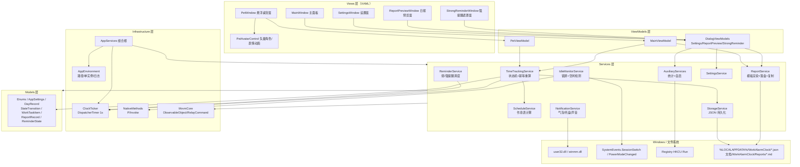
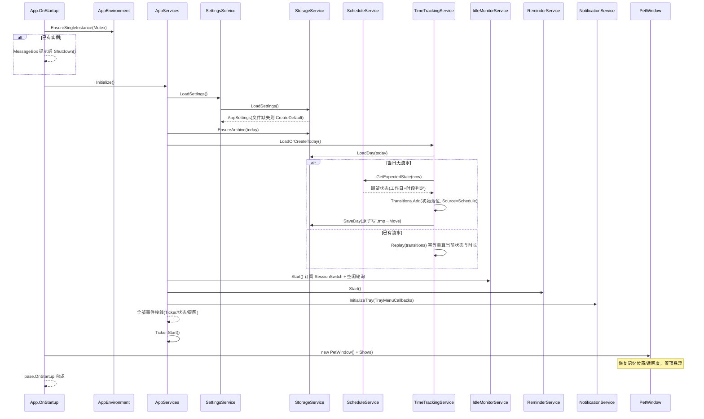
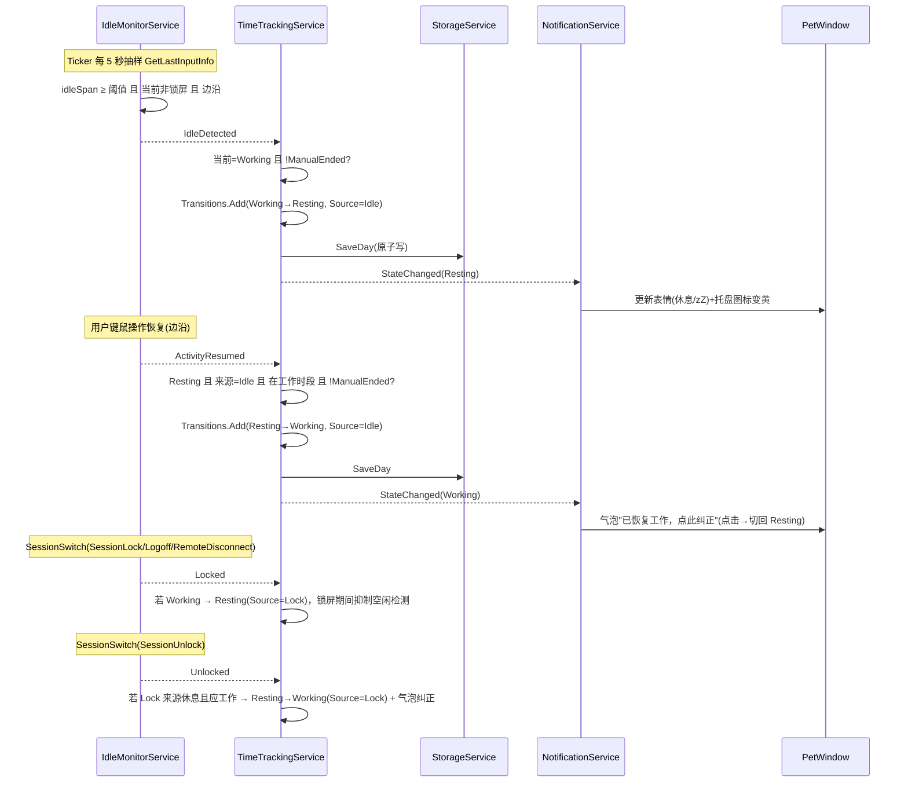
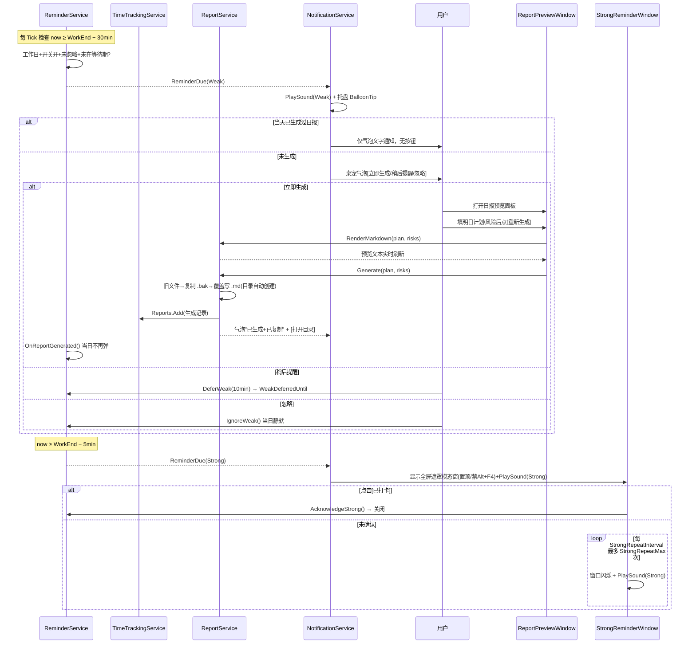
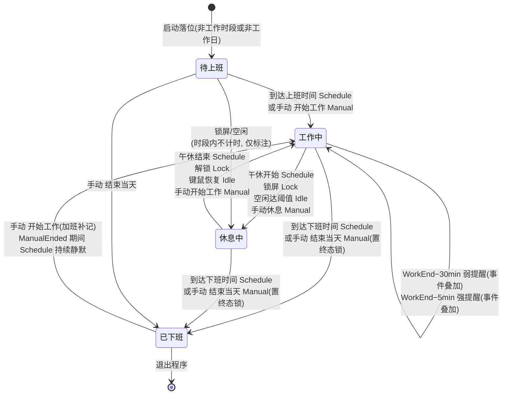
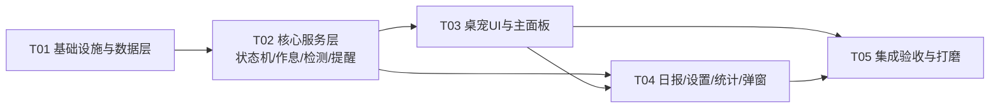

# WorkAlarmClock 工作日记桌宠 — 系统架构设计（ARCHITECTURE.md）

| 项目信息 | 内容 |
|---|---|
| 文档版本 | v1.0 |
| 上游文档 | docs/PRD.md（PRD v1.0） |
| 技术栈 | C# / .NET 10（net10.0-windows）+ WPF + WinForms(NotifyIcon)，**零第三方 NuGet 依赖** |
| 架构模式 | MVVM（自写轻量基类）+ 单例服务组合根（AppServices） |
| 文档语言 | 简体中文（代码签名为英文） |

> **可行性验证声明**：本设计的全部"零 NuGet 关键 API 组合"已在开发机（.NET SDK 10.0.403 / 运行时 10.0.14）上用临时工程编译验证通过（`UseWPF=true` + `UseWindowsForms=true` + `GetLastInputInfo` P/Invoke + `Microsoft.Win32.SystemEvents` + `Microsoft.Win32.Registry` + `System.Windows.Forms.NotifyIcon` + `System.Drawing` GDI+ 动态图标 + `System.Media.SystemSounds` + `System.Text.Json`），**0 警告 0 错误**，且确认 `System.Drawing.Common.dll`、`System.Windows.Extensions.dll`（含 SystemSounds）、`Microsoft.Win32.SystemEvents.dll` 均由 `Microsoft.WindowsDesktop.App` 共享框架自带，`Microsoft.Win32.Registry.dll` 由 `Microsoft.NETCore.App` 自带。工程师可放心按本设计实现，无需引入任何 PackageReference。

---

## 目录

1. [总体架构与组件图](#1-总体架构与组件图)
2. [关键设计决策与取舍](#2-关键设计决策与取舍)
3. [文件清单](#3-文件清单)
4. [核心数据模型](#4-核心数据模型)
5. [核心服务接口](#5-核心服务接口)
6. [关键流程时序图](#6-关键流程时序图)
7. [状态机设计](#7-状态机设计)
8. [有序任务列表](#8-有序任务列表)
9. [跨文件共享约定](#9-跨文件共享约定)
10. [依赖的框架自带程序集（零 NuGet 清单）](#10-依赖的框架自带程序集零-nuget-清单)
11. [风险与待明确事项](#11-风险与待明确事项)
12. [增量修订（v1.1，R-22~R-29）](#增量修订v11r-22r-29)

---

## 1. 总体架构与组件图

### 1.1 分层结构

```
WorkAlarmClock/                       ← 项目根（代码全部在此目录）
├── App.xaml / App.xaml.cs            ← 应用入口：单实例、组合根初始化、全局异常
├── Infrastructure/                   ← 基础设施：MVVM 基类、时钟节拍、P/Invoke、路径/日志
├── Models/                           ← 纯数据模型与枚举（无逻辑依赖）
├── Services/                         ← 业务服务（状态机/作息/检测/提醒/日报/托盘/存储）
├── ViewModels/                       ← 视图模型（绑定与服务编排）
├── Views/                            ← XAML 视图（设置窗、日报预览窗、强提醒窗、桌宠角色控件）
├── MainWindow.xaml                   ← 主面板（复用现有空文件）
└── PetWindow.xaml                    ← 悬浮桌宠窗
```

分层规则（自上而下单向依赖）：

- **Views → ViewModels → Services → Models / Infrastructure**；ViewModel 之间不互相引用（弹窗 VM 与主 VM 通过服务事件解耦）。
- **Models 层零依赖**：只含 POCO/枚举/record，可被任何层引用。
- **Services 层不引用 WPF 控件**（`NotificationService` 是唯一例外，它持有 WinForms NotifyIcon 与气泡回调，属"UI 边界服务"）。
- 服务实例由 **AppServices 组合根**统一构造与接线，全应用单例、生命周期 = 应用生命周期；ViewModel 通过 `AppServices.Xxx` 静态属性获取服务（个人自用规模下接受服务定位器的简洁性，换取零构造函数噪音）。
- 所有业务事件均约定在 **UI 线程**触发/消费（见 §9.6），因此服务层不需要加锁。

### 1.2 组件图



---

## 2. 关键设计决策与取舍

### D-01 为什么能"零 NuGet"——每个被禁包的替代实现

| 被禁的典型 NuGet 包 | 替代实现（已验证） | 关键要点 |
|---|---|---|
| CommunityToolkit.Mvvm | 自写 `ObservableObject`（SetProperty + CallerMemberName）+ `RelayCommand`（含 CanExecute + RaiseCanExecuteChanged）+ `ITicker` | 见 Infrastructure/MvvmCore.cs，约 150 行 |
| Hardcodet.NotifyIcon.Wpf | `System.Windows.Forms.NotifyIcon`（csproj 加 `<UseWindowsForms>true</UseWindowsForms>`） | 见下方"托盘图标注意事项" |
| MahApps / MaterialDesign | 原生 WPF Style/ControlTemplate + XAML 矢量 Path/Ellipse | 桌宠全部矢量绘制，无任何图片资源 |
| Newtonsoft.Json | `System.Text.Json`（BCL 自带） | 见 §9.7 JSON 约定 |
| System.Drawing.Common(NuGet) | `Microsoft.WindowsDesktop.App` 共享框架自带 System.Drawing.Common.dll（UseWindowsForms=true 时可用） | 仅用于运行时绘制 16×16 托盘图标 |
| System.Windows.Extensions(NuGet) | `Microsoft.WindowsDesktop.App` 自带 System.Windows.Extensions.dll → `System.Media.SystemSounds` 可直接用 | UseWindowsForms=true 即生效 |
| Microsoft.Win32.Registry(NuGet) | `Microsoft.NETCore.App` 自带 Microsoft.Win32.Registry.dll | 已编译验证；无需 advapi32 P/Invoke 备选（保留说明见 §11） |

**托盘图标（NotifyIcon）注意事项**：

- `NotifyIcon` 必须在 **UI STA 线程**创建（WPF Dispatcher 消息循环与其共享同一线程消息泵，事件可直接回 UI 线程）。
- `NotifyIcon.Icon` 不能为 null。用 GDI+ 运行时画 16×16 位图取句柄：

```csharp
using var bmp = new System.Drawing.Bitmap(16, 16);
using var g = System.Drawing.Graphics.FromImage(bmp);
g.Clear(color);                       // 绿=工作中 / 黄=休息 / 灰=已下班 / 橙=提醒
IntPtr hIcon = bmp.GetHicon();
_notifyIcon.Icon = System.Drawing.Icon.FromHandle(hIcon);
// 换图标前必须 DestroyIcon(旧句柄)；程序退出前 _notifyIcon.Visible=false + Dispose + DestroyIcon
```

- tooltip 受系统 **63 字符**限制，格式 `"工作中 09:41 已工作00:41"`。
- 菜单用 WinForms `ContextMenuStrip`，各菜单项 Click 转发到对应 RelayCommand（`MainViewModel` 暴露命令属性供托盘与主面板共用，见 §9.8）。
- 程序退出必须 `Visible=false`，否则托盘残留"幽灵图标"。

### D-02 悬浮桌宠窗：透明、置顶、拖动、吸附

- 窗口属性：`WindowStyle="None" AllowsTransparency="True" Background="Transparent" Topmost="True" ShowInTaskbar="False" ResizeMode="NoResize" Focusable="False"`。
- **不使用 `Window.DragMove()`**：DragMove 进入模态拖动循环，会吞掉 MouseDoubleClick 且释放后无法立刻判断落点距离。改为 code-behind 手工拖动（§9.4 允许的少数视图行为之一）：

```csharp
// MouseLeftButtonDown: 记录 _dragStart = e.GetPosition(this)，CaptureMouse
// MouseMove(捕获中): Left/Top += (pos - _dragStart)，并累计移动量
// MouseLeftButtonUp: ReleaseCapture；若距左右边缘或工作区顶 ≤30px → 吸附并播放收缩动画
// 收缩态: 外层 Canvas 宽度动画到 6px、Opacity→0.35；MouseEnter 播放展开动画恢复
// MouseDoubleClick(移动量<系统阈值时才算): 打开主面板
```

- 吸附基准使用 `SystemParameters.WorkArea`（避免被任务栏遮住）。
- 窗口位置持久化：退出时把 `Left/Top/是否收缩` 写入 settings.json，启动恢复。

### D-03 单实例 Mutex

```csharp
// App.OnStartup 最开头：
_createdNewMutex = new Mutex(initiallyOwned: true, @"Local\WorkAlarmClock_SingleInstance", out bool createdNew);
if (!createdNew) { System.Windows.MessageBox.Show("WorkAlarmClock 已在运行。"); Shutdown(); return; }
```

- `Local\` 前缀保证仅当前用户会话单实例；字段持有引用防 GC；`OnExit` 中 ReleaseMutex/Dispose。

### D-04 时钟与计时精度方案（重要）

**核心原则：时长不是"增量累加的计数器"，而是"由状态切换流水即时重算的派生值"。**

- `ClockTicker`：唯一一个 `DispatcherTimer`，1 秒 Tick（UI 线程）。所有周期性工作（时钟显示、作息点判定、提醒检查、空闲轮询按 5 秒抽样、主面板刷新）都订阅它的 `Tick` 事件，**全应用只有一个计时器**。
- 秒级 UI 刷新：每次 Tick 更新 `Now` 并由 ViewModel 属性 setter 推送。
- 分钟级累计：工作/休息时长 = `TimeTrackingService` 在 Tick 时按"流水重放 + 当前开放段"计算（见 D-05），代价为 O(流水条数)，一天 < 200 条，完全无压力。
- 作息点切换（≤10s 验收）：Tick 每秒比对 `now` 与 `ScheduleService.NextTransitionAt(now)`，误差 ≤1s。
- **系统时钟修改 / 睡眠唤醒**：额外订阅 `Microsoft.Win32.SystemEvents.PowerModeChanged`（Resume 时触发一次全量重算与落位），流水区间出现负值时 clamp 为 0（见 D-05）。所有"经过时长"类比较一律用 `DateTimeOffset` 两个快照相减，不用 `Environment.TickCount` 累加器。

### D-05 持久化与幂等重算算法（R-14）

**数据模型**：每日一个 `DayRecord`，核心是**状态切换流水 `Transitions`**（只追加、不修改），时长/当前状态全部从流水派生，永不单独存储 → 天然幂等。

```
重算算法 Replay(transitions, now):
  prevState = BeforeWork(若流水第一条前需要落位，落位记录本身也入流水)
  prevTime  = 流水第一条.Time
  work = rest = 0s
  foreach t in transitions.OrderBy(Time):
      span = t.Time - prevTime
      if (span > 0):
          if prevState == Working: work += span
          elif prevState == Resting: rest += span
      prevState = t.To; prevTime = t.Time
  // 开放段：
  span = now - prevTime
  if (span > 0):
      if prevState == Working: work += span
      elif prevState == Resting: rest += span
  return (prevState, work, rest)
```

- **启动落位**：当日无流水 → 写入一条初始落位 Transition（`Source=Schedule`，From=BeforeWork，To=按作息推算的期望状态）；有流水 → 直接 Replay 得到当前状态。**跨时间点启动**（10:00 启动）由初始落位一次性纠正。
- **强杀恢复**：状态切换的瞬间即整文件落盘（原子写），重启 Replay 即恢复，丢失窗口 = 0；无流水的"进行中时间"由开放段重算，仅损失最后一条未落盘切换（分钟级可接受，符合验收）。
- **原子写**：先写 `YYYY-MM-DD.json.tmp`，再 `File.Move(tmp, target, overwrite:true)`（File.Move 在 .NET Core 3.0+ 支持 overwrite 且同卷为原子替换）。
- **跨天归档**：启动或 Tick 发现 `Today.Date != record.Date` → 旧文件留在 data 目录（即归档），加载/新建当日记录，`ReminderService.ResetForNewDay()`。不需要显式搬移。
- **配置持久化**：`%LOCALAPPDATA%/WorkAlarmClock/settings.json`，同样原子写，保存即写。

### D-06 锁屏与空闲检测（R-06/R-07）

- **锁屏**：`Microsoft.Win32.SystemEvents.SessionSwitch`（在 App/UI 线程订阅，事件回 UI 线程）。`SessionLock / SessionLogoff / SessionRemoteDisconnect / SessionSuspend`?——注意 Suspend 不属于 SessionSwitch，休眠走 PowerModeChanged。判定集合：`SessionLock`、`SessionLogoff`、`SessionRemoteDisconnect` → 视为"锁屏/离开"→ Resting(Source=Lock)；`SessionUnlock` → 解锁恢复流程。锁屏期间抑制空闲检测（防止双重休息来源打架）。
- **空闲**：`GetLastInputInfo` P/Invoke 签名（已验证）：

```csharp
[StructLayout(LayoutKind.Sequential)]
internal struct LASTINPUTINFO { public uint cbSize; public uint dwTime; }

[DllImport("user32.dll")]
[return: MarshalAs(UnmanagedType.Bool)]
private static extern bool GetLastInputInfo(ref LASTINPUTINFO plii);

// 空闲毫秒 = unchecked((uint)Environment.TickCount - plii.dwTime)
// 注意 dwTime 是 32 位 GetTickCount 系，必须用 unchecked uint 减法避免负数
```

- 轮询频率：每 5 秒（由 ClockTicker Tick 计数抽样）。**只在状态边沿触发事件**（活动→空闲、空闲→活动），不重复报。
- 恢复策略（默认）：解锁/回岗时，若当前是 Lock/Idle 来源的休息，且时段处于工作时段内（非午休、未下班、未 ManualEnded）→ 自动恢复 Working + 气泡"已恢复工作，点此纠正"（点击气泡 → 切回 Resting）。
- 计时策略开关 `CountIdleAsWork`：默认 false，即 Lock/Idle 段计入休息时长；设 true 时 Idle 段改计入工作时长（Lock 段始终计入休息，PRD 已定）。

### D-07 提示音（无音频资源文件）

- 首选 `System.Media.SystemSounds.Exclamation / Asterisk / Beep.Play()`（已验证编译运行可用，随 WindowsDesktop 共享框架分发）。
- 保底 P/Invoke（也一并写好，便于差异化音效）：
  - `user32.dll!MessageBeep(0x30)`（MB_ICONWARNING，强提醒用）、`MessageBeep(0x40)`（MB_ICONASTERISK，弱提醒用）
  - `winmm.dll!PlaySound("SystemExclamation", IntPtr.Zero, SND_ALIAS|SND_ASYNC)`（可选，不强求）
- 声音总开关 `SoundEnabled` 于设置；强提醒"未确认每 60s 重复最多 3 次"用声音 + 窗口闪烁（Storyboard 闪 Window.Opacity / 边框颜色）实现。

### D-08 手动优先与终态锁的精确规则（R-05/R-08）

优先级：**手动 Manual > 作息 Schedule > 检测类（Lock > Idle）**。精确语义：

1. 手动操作**立即生效**，且立即落盘；同 Tick 内若检测事件与之冲突，以手动结果为准（服务按事件到达顺序处理，手动到达即覆盖，下一 Tick 状态机重新收敛）。
2. `ManualEnded=true`（手动"结束当天"）：当天 **Schedule 自动切换全部静默**、检测类**不自动恢复工作**；仅允许手动"开始工作"重开（加班补记），重开后检测类恢复逻辑照常、Schedule 继续静默。该标志跨天（ResetForNewDay）后清除。
3. 手动"开始休息"：切 Resting(Manual)；后续 Schedule/检测**照常运作**（到点自动落位/回岗自动恢复），这样"午休结束回岗自动恢复工作"等可预期行为不被手动休息卡死。此为默认策略，见 §11 待确认。
4. 提醒类（弱/强）与主状态机**解耦**：只取决于时间点 + 工作日 + 开关，不因 ManualEnded 静默（防提前下班忘写日报），但"已生成日报"标志会改变弱提醒行为（见 D-09）。

### D-09 弱/强提醒策略（R-09/R-10）

- 弱提醒触发点 = `WorkEnd − WeakReminderLead(默认30min)`；触发条件：工作日 + 开关开 + 未忽略 + 未在"稍后"等待中。形态：桌宠气泡（8 秒淡出，鼠标悬停不清除）+ 提示音 + 托盘 BalloonTip，三按钮 `[立即生成] [稍后提醒] [忽略]`：
  - 立即生成 → `ReportService.Generate()` → 落盘 + 复制剪贴板 + 气泡反馈；当日标记 `ReportGenerated`。
  - 稍后提醒 → `WeakDeferredUntil = now + 10min`，到点再弹。
  - 忽略 → 当日静默。
  - 若触发时**当天已生成过日报** → 只弹托盘通知 + 气泡文字，无按钮。
- 强提醒触发点 = `WorkEnd − StrongReminderLead(默认5min)`；模态置顶遮罩窗（覆盖 `SystemParameters.VirtualScreen`，半透明 `#B3000000`，`Topmost`，禁 Alt+F4：`OnClosing` 中 `e.Cancel`，仅"已打卡"按钮置 `_allowClose=true` 后 `Close()`）。未确认：每 `StrongRepeatInterval(60s)` 声音+闪烁，重复 `StrongRepeatMax(3)` 次；`StrongAllowIgnore` 默认 false。确认后 `ReminderState.StrongConfirmed=true`，当日不再弹。

### D-10 日报生成（R-12/R-13/R-19）

- 模板 = 设置中的可编辑字符串（默认即 PRD 中模板）；占位符 `{{Date}} {{WorkDuration}} {{RestDuration}} {{LunchRange}} {{Tasks}} {{TomorrowPlan}} {{Risks}}` 用简单 `string.Replace` 替换（占位符集合固定，不用正则）。
- `{{Tasks}}` → 编号列表：`1. 09:15 需求评审`（时间戳 `HH:mm`）；无事项 → `（暂无记录）`。
- `{{WorkDuration}}/{{RestDuration}}` → `7小时42分` 中文格式；`{{LunchRange}}` → `12:00–13:00` 或 `未启用`。
- 落盘：`ReportDirectory`(默认 `我的文档\WorkAlarmClock\Reports`)，`Directory.CreateDirectory` 递归创建；已存在 → 旧文件复制为 `YYYY-MM-DD.md.bak`，再覆盖写。
- 复制剪贴板：`System.Windows.Clipboard.SetText`（UI 线程），成功气泡反馈 + `[打开目录]`（`Process.Start("explorer.exe", folder)`）。
- 预览面板（R-19）：左只读预览（实时重渲染）、右侧编辑"明日计划/风险待办"（默认 `-`）后 `[重新生成]`。

### D-11 WPF + WinForms 混用的命名空间冲突防御

- csproj 同时 `UseWPF` + `UseWindowsForms` 后，`Application`、`MessageBox`、`Clipboard` 存在二义性。**强制约定**：
  - WinForms 类型一律别名引用：`using WF = System.Windows.Forms;`，或全限定 `System.Windows.Forms.NotifyIcon`。
  - WPF 侧统一 `using System.Windows;`；`MessageBox` 一律 `System.Windows.MessageBox` 全限定书写。
  - XAML 中不需要引用 WinForms 命名空间（托盘纯代码构造）。

### D-12 开机自启（R-20，P2）

- 首选（已验证可用）：`Microsoft.Win32.Registry.CurrentUser.OpenSubKey(@"Software\Microsoft\Windows\CurrentVersion\Run", writable:true)`，`SetValue("WorkAlarmClock", "\"{Environment.ProcessPath}\"")`；关闭用 `DeleteValue("WorkAlarmClock", throwOnMissingValue:false)`。
- 备选（无需采用，但写入文档兜底）：若未来 TFM 变更导致 Registry 类型缺失，改用 P/Invoke `advapi32.dll!RegOpenKeyEx/RegSetValueEx` 或 `Process.Start("reg.exe", "add ...")`，同样零 NuGet。

---

## 3. 文件清单

预估总量：**28 个条目 / 约 22 个源文件**（XAML 与其 code-behind 合并计 1）。`M`=修改现有文件，`N`=新建。

| # | 相对路径（项目目录下） | 职责 | M/N | 预估规模 |
|---|---|---|---|---|
| 1 | `WorkAlarmClock.csproj` | 加 `UseWindowsForms=true`；保持零 PackageReference | M | 2 行 |
| 2 | `App.xaml` / `App.xaml.cs` | 去 StartupUri；OnStartup：Mutex 单实例→组合根→托盘→悬浮窗；OnExit 清理；DispatcherUnhandledException 全局兜底 | M | ~160 行 |
| 3 | `Infrastructure/MvvmCore.cs` | ObservableObject、RelayCommand、ITicker 接口、ClockTicker(DispatcherTimer 1s，可注入时钟源) | N | ~150 行 |
| 4 | `Infrastructure/NativeMethods.cs` | LASTINPUTINFO 结构体 + GetLastInputInfo / MessageBeep / DestroyIcon / PlaySound P/Invoke | N | ~80 行 |
| 5 | `Infrastructure/AppEnvironment.cs` | 数据/报表/日志目录约定、单实例 Mutex、轻量文件日志、TextFormats(时长/时间格式化静态方法) | N | ~180 行 |
| 6 | `Models/Enums.cs` | WorkState、TriggerSource、RestSource、ReminderKind、SchedulePointKind、BubbleKind、SoundKind | N | ~60 行 |
| 7 | `Models/AppSettings.cs` | 全部设置项 POCO + `CreateDefault()` | N | ~150 行 |
| 8 | `Models/DayRecord.cs` | StateTransition、WorkTaskItem、ReportRecord、DayRecord、ReminderState | N | ~160 行 |
| 9 | `Services/ServiceInterfaces.cs` | 全部 9 个接口 + ValidationResult、SchedulePoint、TrayMenuCallbacks | N | ~200 行 |
| 10 | `Services/SettingsService.cs` | 设置加载/校验/更新/变更广播 | N | ~160 行 |
| 11 | `Services/StorageService.cs` | settings.json + data/YYYY-MM-DD.json 读写、原子写、跨天归档、LoadWeek | N | ~180 行 |
| 12 | `Services/ScheduleService.cs` | 工作日判定、期望状态推算、今日时间点、下一切换点 | N | ~170 行 |
| 13 | `Services/TimeTrackingService.cs` | 状态机核心：落位、手动切换、检测事件、终态锁、幂等 Replay 重算、事项 CRUD、Tick 刷新 | N | ~300 行 |
| 14 | `Services/IdleMonitorService.cs` | SessionSwitch 锁屏检测 + GetLastInputInfo 5 秒抽样轮询，边沿事件 | N | ~180 行 |
| 15 | `Services/ReminderService.cs` | 弱/强提醒触发条件与调度、稍后/忽略/确认/重复策略、跨天重置 | N | ~200 行 |
| 16 | `Services/ReportService.cs` | 模板占位符渲染、落盘+.bak、剪贴板、路径推导 | N | ~180 行 |
| 17 | `Services/NotificationService.cs` | NotifyIcon 生命周期与动态图标、托盘菜单接线、气泡队列、托盘 Balloon、声音播放 | N | ~260 行 |
| 18 | `Services/AuxiliaryServices.cs` | StatisticsService(今日/本周聚合) + AutoStartService(注册表) | N | ~140 行 |
| 19 | `Services/AppServices.cs` | 组合根：构造全部服务单例、事件接线、Initialize/Shutdown | N | ~170 行 |
| 20 | `ViewModels/PetViewModel.cs` | 时钟/时长/状态/气泡文本、双击打开主面板命令 | N | ~160 行 |
| 21 | `ViewModels/MainViewModel.cs` | 状态胶囊、三操作命令(含 CanExecute)、事项列表 CRUD、生成/预览/统计/设置命令、今日+本周统计属性 | N | ~280 行 |
| 22 | `ViewModels/DialogViewModels.cs` | SettingsViewModel(草稿+校验+保存)、ReportPreviewViewModel(预览/编辑/重生成/复制)、StrongReminderViewModel(确认/重复) | N | ~320 行 |
| 23 | `PetWindow.xaml` / `.cs` | 悬浮窗：透明置顶、手工拖动、贴边吸附收缩、双击/右键菜单、气泡宿主；内嵌桌宠控件 | N | ~380 行 |
| 24 | `Views/PetAvatarControl.xaml` / `.cs` | 纯矢量卡通角色：5 套表情(工作/休息/午休/弱提醒/强提醒)+待机 Storyboard(眨眼/敲键盘/zZ/举牌/跳跃)，状态切换 DataTrigger 换 VisualState | N | ~320 行 |
| 25 | `MainWindow.xaml` / `.cs` | **改造为"主面板"**：顶栏状态+时长胶囊、操作行、事项列表+输入、底部四按钮；关闭=隐藏驻留 | M | ~260 行 |
| 26 | `Views/SettingsWindow.xaml` / `.cs` | 五区 Tab(作息/提醒/检测/外观/存储)、FolderBrowserDialog 选目录、模板多行编辑、校验错误红字 | N | ~300 行 |
| 27 | `Views/ReportPreviewWindow.xaml` / `.cs` | 左预览右编辑、重新生成/打开目录/复制/关闭 | N | ~180 行 |
| 28 | `Views/StrongReminderWindow.xaml` / `.cs` | 全屏遮罩模态置顶、禁 Alt+F4、确认按钮、闪烁动画 | N | ~140 行 |

> `AssemblyInfo.cs` 无需改动。`obj/`、`bin/` 忽略。

---

## 4. 核心数据模型

> 全部 public，属性可空注解严格（`Nullable=enable` 下零警告）。枚举持久化为字符串（`JsonStringEnumConverter`）。

```csharp
namespace WorkAlarmClock.Models;

/// <summary>主状态机状态。</summary>
public enum WorkState
{
    BeforeWork,   // 待上班
    Working,      // 工作中
    Resting,      // 休息中（来源见 RestSource）
    OffWork       // 已下班
}

/// <summary>状态切换的触发来源（持久化进流水）。</summary>
public enum TriggerSource
{
    Schedule,     // 作息表自动
    Manual,       // 用户手动
    Lock,         // 锁屏检测
    Idle,         // 空闲检测
    System        // 系统事件（初始落位/睡眠唤醒重落位）
}

/// <summary>休息的具体来源（气泡注明）。</summary>
public enum RestSource
{
    Lunch,        // 午休
    LockScreen,   // 锁屏
    Idle,         // 空闲
    Manual        // 手动
}

public enum ReminderKind { Weak, Strong }
public enum SchedulePointKind { WorkStart, LunchStart, LunchEnd, WorkEnd }
public enum BubbleKind { Info, RestResume, ReminderWeak, ReminderStrong }
public enum SoundKind { Weak, Strong, Confirm }

/// <summary>应用设置（settings.json 反序列化目标）。</summary>
public sealed class AppSettings
{
    // 作息
    public TimeOnly WorkStartTime { get; set; } = new(9, 0);
    public TimeOnly WorkEndTime   { get; set; } = new(18, 0);
    public bool     LunchEnabled  { get; set; } = true;
    public TimeOnly LunchStartTime { get; set; } = new(12, 0);
    public TimeOnly LunchEndTime   { get; set; } = new(13, 0);
    /// 周日..周六 7 个布尔（下标 = DayOfWeek 枚举值），默认周六日为 false。
    public bool[] Workdays { get; set; } = new bool[7];

    // 提醒
    public bool WeakReminderEnabled { get; set; } = true;
    public int  WeakReminderLeadMinutes { get; set; } = 30;
    public bool StrongReminderEnabled { get; set; } = true;
    public int  StrongReminderLeadMinutes { get; set; } = 5;
    public bool StrongAllowIgnore { get; set; } = false;
    public int  StrongRepeatIntervalSeconds { get; set; } = 60;
    public int  StrongRepeatMaxCount { get; set; } = 3;
    public bool SoundEnabled { get; set; } = true;

    // 检测
    public int  IdleThresholdMinutes { get; set; } = 5;
    public bool LockAsRest { get; set; } = true;   // 锁屏即休息（默认开）
    public bool CountIdleAsWork { get; set; } = false;

    // 外观/存储
    public double PetOpacity { get; set; } = 0.8;   // 0.2–1.0
    public string ReportDirectory { get; set; } = ""; // 空 = 默认 我的文档\WorkAlarmClock\Reports
    public string ReportTemplate { get; set; } = "";   // 空 = 内置默认模板
    public bool AutoStart { get; set; } = false;      // R-20，默认关

    // 桌宠位置记忆
    public double PetLeft { get; set; } = double.NaN;
    public double PetTop { get; set; } = double.NaN;

    public static AppSettings CreateDefault();
}

/// <summary>一条状态切换流水（只追加）。</summary>
public sealed class StateTransition
{
    public DateTimeOffset Time { get; set; }
    public WorkState From { get; set; }
    public WorkState To { get; set; }
    public TriggerSource Source { get; set; }
    public string? Note { get; set; }     // 例如 "午休" / "锁屏" / "空闲"
}

/// <summary>今日事项条目。</summary>
public sealed class WorkTaskItem
{
    public Guid Id { get; set; } = Guid.NewGuid();
    public DateTimeOffset Timestamp { get; set; }  // 展示精度=分钟
    public string Text { get; set; } = "";
}

/// <summary>一次日报生成记录。</summary>
public sealed class ReportRecord
{
    public DateTimeOffset GeneratedAt { get; set; }
    public string FilePath { get; set; } = "";
    public string TomorrowPlan { get; set; } = "-";
    public string Risks { get; set; } = "-";
}

/// <summary>每日数据（data/YYYY-MM-DD.json 反序列化目标）。</summary>
public sealed class DayRecord
{
    public DateOnly Date { get; set; }
    public List<StateTransition> Transitions { get; set; } = new();
    public List<WorkTaskItem> Tasks { get; set; } = new();
    public List<ReportRecord> Reports { get; set; } = new();
    /// 手动"结束当天"终态锁，跨天清除。
    public bool ManualEnded { get; set; }
}

/// <summary>当日提醒进度（不持久化，内存态即可；跨天重置）。</summary>
public sealed class ReminderState
{
    public bool WeakFired { get; set; }
    public DateTimeOffset? WeakDeferredUntil { get; set; }
    public bool WeakIgnored { get; set; }
    public bool StrongFired { get; set; }
    public bool StrongConfirmed { get; set; }
    public int StrongRepeatCount { get; set; }
    public void ResetForNewDay();
}
```

---

## 5. 核心服务接口

```csharp
namespace WorkAlarmClock.Services;

public readonly record struct ValidationResult(bool Ok, string? Error);
public readonly record struct SchedulePoint(TimeOnly Time, SchedulePointKind Kind);

/// <summary>唯一时钟节拍（UI 线程，1 秒），可注入时间源便于测试。</summary>
public interface ITicker
{
    DateTimeOffset Now { get; }
    event EventHandler? Tick;
    void Start();
}

public interface ISettingsService
{
    AppSettings Current { get; }
    event EventHandler? SettingsChanged;
    ValidationResult Validate(AppSettings candidate);          // 非法输入校验（§9.2 规则）
    /// <summary>校验通过→保存→广播；失败返回错误文案。</summary>
    ValidationResult TryUpdate(AppSettings candidate);
}

public interface IStorageService
{
    AppSettings LoadSettings();
    void SaveSettings(AppSettings settings);                  // 原子写
    DayRecord? LoadDay(DateOnly date);
    void SaveDay(DayRecord record);                           // 原子写
    /// <summary>周一至今的每日记录（本周统计用）。</summary>
    IReadOnlyList<DayRecord> LoadWeek(DateContaining today);
    void EnsureArchive(DateOnly today);                        // 跨天检查（旧文件留置即归档）
}

public interface IScheduleService
{
    bool IsWorkday(DateOnly date);
    /// <summary>按作息推算"现在理应处于的状态"（不看流水/手动锁）。</summary>
    WorkState GetExpectedState(DateTimeOffset now);
    /// <summary>今天的全部作息时间点（升序；午休关闭则无午休两点）。</summary>
    IReadOnlyList<SchedulePoint> GetTodayPoints(DateOnly date);
    /// <summary>下一个自动切换时间点（今天已过完则返回明天首个，或 null=非工作日）。</summary>
    DateTimeOffset? NextTransitionAt(DateTimeOffset now);
}

public interface ITimeTrackingService
{
    WorkState CurrentState { get; }
    RestSource? CurrentRestSource { get; }
    bool ManualEnded { get; }
    DayRecord Today { get; }

    event EventHandler<WorkState>? StateChanged;   // UI 线程
    event EventHandler? TasksChanged;

    TimeSpan WorkDuration { get; }                  // Replay 派生，Tick 时更新
    TimeSpan RestDuration { get; }

    /// <summary>启动/跨天时调用：加载或按作息落位（写初始流水）。</summary>
    void LoadOrCreateToday();
    /// <summary>到作息点时由 Reminder/Tick 驱动落位（受 ManualEnded 静默约束）。</summary>
    void ApplySchedulePoint(SchedulePointKind kind);
    bool TryManualSwitch(WorkState target, out string? error);  // Manual，最高优先
    void OnLocked(); void OnUnlocked();
    void OnIdleDetected(); void OnActivityResumed();
    void AddTask(string text); bool RemoveTask(Guid id);
    void RefreshDurations();                        // 每 Tick 重算 Work/RestDuration
}

public interface IIdleMonitorService
{
    bool IsLocked { get; } bool IsIdle { get; }
    TimeSpan CurrentIdleSpan { get; }
    event EventHandler? Locked;
    event EventHandler? Unlocked;
    event EventHandler? IdleDetected;
    event EventHandler? ActivityResumed;
    void Start(); void Stop();
}

public interface IReminderService
{
    ReminderState State { get; }
    event EventHandler<ReminderKind>? ReminderDue;   // UI 线程
    void Start(); void Stop();
    void DeferWeak(TimeSpan delay);                  // 稍后 10 分钟
    void IgnoreWeak();
    void AcknowledgeStrong();                         // 已打卡
    void OnReportGenerated();
    void ResetForNewDay();
}

public interface IReportService
{
    /// <summary>渲染 Markdown（不落盘），供预览面板实时刷新。</summary>
    string RenderMarkdown(string tomorrowPlan, string risks);
    /// <summary>渲染+落盘（.bak 备份）+写入 DayRecord.Reports，返回生成记录。</summary>
    ReportRecord Generate(string tomorrowPlan, string risks);
    bool CopyToClipboard(string content);
    string ResolveReportDirectory();                  // 空配置→默认目录
    string GetReportPath(DateOnly date);
}

public interface INotificationService
{
    /// <summary>桌宠气泡：消息 8 秒淡出；actionLabel+action 提供点击纠正。</summary>
    void ShowBubble(string message, BubbleKind kind, string? actionLabel = null, Action? action = null);
    void ShowTrayBalloon(string title, string message);
    void PlaySound(SoundKind kind);
    /// <summary>托盘状态图标+tooltip 更新（每 Tick 调用，内部节流）。</summary>
    void UpdateTray(WorkState state, string tooltip);
    /// <summary>App 启动后接线：托盘菜单命令来自 MainViewModel。</summary>
    void InitializeTray(TrayMenuCallbacks callbacks);
    void ShowMainPanel();                             // 托盘双击/菜单
}

public sealed record TrayMenuCallbacks(
    Action openMainPanel, Action startWork, Action startRest,
    Action endDay, Action generateReport,
    Action openSettings, Action exitApp);

public interface IStatisticsService
{
    /// <summary>今日工作/休息 + 本周（工作日）累计。</summary>
    WeekStats GetStats();
}
public sealed record WeekStats(TimeSpan TodayWork, TimeSpan TodayRest,
                               TimeSpan WeekWork, TimeSpan WeekRest);

public interface IAutoStartService
{
    bool IsEnabled();
    void SetEnabled(bool enabled);   // HKCU\...\Run 增删
}
```

**组合根**（服务定位入口，ViewModel/视图统一经此取服务）：

```csharp
namespace WorkAlarmClock.Services;

public static class AppServices
{
    public static ITicker Ticker { get; }
    public static ISettingsService Settings { get; }
    public static IStorageService Storage { get; }
    public static IScheduleService Schedule { get; }
    public static IIdleMonitorService IdleMonitor { get; }
    public static ITimeTrackingService TimeTracking { get; }
    public static IReminderService Reminder { get; }
    public static IReportService Report { get; }
    public static INotificationService Notification { get; }
    public static IStatisticsService Statistics { get; }
    public static IAutoStartService AutoStart { get; }

    /// <summary>App.OnStartup 调用。顺序：Settings→Storage→Schedule→TimeTracking(落位)
    /// →IdleMonitor→Reminder→Notification→事件接线→Ticker.Start()。</summary>
    public static void Initialize();
    public static void Shutdown();   // 解除事件订阅、托盘清理
}
```

---

## 6. 关键流程时序图

### 6.1 ① 启动初始化与状态落位



### 6.2 ② 空闲/锁屏触发休息与恢复



### 6.3 ③ 下班前提醒与日报生成



---

## 7. 状态机设计

优先级（高→低）：**Manual（手动） > Schedule（作息表） > Lock（锁屏） > Idle（空闲）**。
弱/强提醒是叠加在主状态之上的**子状态/事件**，不改变主状态归属。



状态机裁决补充规则（实现于 `TimeTrackingService`）：

1. **边沿触发**：任何"切到自己"的请求是 no-op，不写流水。
2. **ManualEnded**：当天 Schedule 全静默、检测类不恢复工作；手动重开后检测类恢复照常。跨天 `ResetForNewDay` 清除。
3. **落位一致性**：每次 Tick 用 `ScheduleService.GetExpectedState(now)` 与当前状态做**兜底对账**（仅当差异源于"错过的作息点"且无手动锁时纠正），保证睡眠唤醒/时钟跳变后 10 秒内收敛。
4. **休息来源标注**：Resting 状态携带 `RestSource`，气泡文案：午休/锁屏/空闲/手动。
5. **非工作日**：停在 BeforeWork，不自动计时、不提醒；手动开始工作仍可记录（加班）。

---

## 8. 有序任务列表

> 共 5 个任务（T01–T05），按依赖顺序执行；每个任务完成标准 = `dotnet build` 0 警告 0 错误 + 对应验收点通过。

---

### T01 项目基础设施与数据层（P0）

**依赖**：无（首个任务）
**涉及文件**：`WorkAlarmClock.csproj`、`App.xaml`、`App.xaml.cs`、`Infrastructure/MvvmCore.cs`、`Infrastructure/NativeMethods.cs`、`Infrastructure/AppEnvironment.cs`、`Models/Enums.cs`、`Models/AppSettings.cs`、`Models/DayRecord.cs`、`Services/ServiceInterfaces.cs`、`Services/SettingsService.cs`、`Services/StorageService.cs`、`Services/AppServices.cs`（组合根雏形：本任务只装 Settings/Storage/Ticker，后续任务逐个补注册）

**实现要点**：
1. csproj 加 `<UseWindowsForms>true</UseWindowsForms>`；确认无任何 PackageReference。
2. App.xaml 去 `StartupUri`；`App.OnStartup`：Mutex 单实例（已有实例 → `System.Windows.MessageBox` 提示 + Shutdown）→ `AppServices.Initialize()`（本阶段仅加载设置/存储）→ 显示空 PetWindow 占位（或临时主窗体）→ `DispatcherUnhandledException` 全局兜底（日志 + MessageBox）。`OnExit`：ReleaseMutex、托盘清理（本阶段可空）。
3. MvvmCore：`ObservableObject.SetProperty<T>(ref T, T, [CallerMemberName] string?)`；`RelayCommand(Action, Func<bool>?)` 实现 `ICommand`，暴露 `RaiseCanExecuteChanged()`；`ITicker` + `ClockTicker`（`DispatcherTimer` 1s + `Func<DateTimeOffset>` 时钟源，默认 `()=>DateTimeOffset.Now`，便于测试注入）。
4. NativeMethods：LASTINPUTINFO 结构体 + `GetLastInputInfo` + `MessageBeep` + `DestroyIcon`（internal static class，SuppressUnmanagedCodeSecurity 不需要）。
5. AppEnvironment：`DataDir=%LOCALAPPDATA%/WorkAlarmClock`、`SettingsPath`、`DefaultReportDir=我的文档\WorkAlarmClock\Reports`、`EnsureDirectory`、`Log(Exception/string)`（写 `logs/app-YYYY-MM.log`，失败吞掉）、`TextFormats` 静态类（`DurationToHm(TimeSpan)→"07:42"`、`DurationToChinese(TimeSpan)→"7小时42分"`、`TimeToHm`）。
6. Models 三文件按 §4 签名落盘。
7. ServiceInterfaces.cs 按 §5 落盘全部接口（含本任务未实现的，先声明）。
8. StorageService：JSON 选项见 §9.7；原子写（写 .tmp 再 `File.Move(overwrite:true)`）；`LoadSettings/SaveSettings/LoadDay/SaveDay/EnsureArchive/LoadWeek`。注意 `LoadWeek` 读周一→今天的文件，文件缺失跳过。
9. SettingsService：`LoadSettings`（文件损坏/缺失 → 默认值并立即回写）、`Validate`（规则见 §9.2）、`TryUpdate`（校验→保存→`SettingsChanged` 广播）。

**验收**：程序可启动且单实例生效；手动改 settings.json 后启动能读到；设置校验规则可被单元性验证（临时日志输出）；`dotnet list package` 无任何包。

---

### T02 核心服务层：状态机·作息·检测·提醒·通知（P0）

**依赖**：T01
**涉及文件**：`Services/ScheduleService.cs`、`Services/TimeTrackingService.cs`、`Services/IdleMonitorService.cs`、`Services/ReminderService.cs`、`Services/NotificationService.cs`、`Services/AppServices.cs`（补全注册与事件接线）

**实现要点**：
1. ScheduleService：`IsWorkday`（bool[7]，下标=DayOfWeek 值，注意周日=0）；`GetExpectedState`：非工作日→BeforeWork；<上班→BeforeWork；[上班,午休)→Working；[午休,午休止)→Resting(Lunch)（午休关闭则跳过）；[午休止,下班)→Working；≥下班→OffWork。`GetTodayPoints` 升序；`NextTransitionAt` 含"今天过完找明天工作日首个点"。
2. TimeTrackingService（核心，约 300 行）：
   - `LoadOrCreateToday`：加载流水；空则写初始落位 Transition（Source=Schedule，To=GetExpectedState）；随后 `RefreshDurations`。
   - `RefreshDurations`：实现 §2 D-05 Replay 算法（负 span clamp 0）；每 Tick 调用。
   - `ApplySchedulePoint(kind)`：ManualEnded=true 时直接 return（静默）；目标状态与当前相同则 no-op；否则写流水。
   - `TryManualSwitch`：Working/Resting 直接切；OffWork 分两种——手动"结束当天"（置 ManualEnded=true）与 ManualEnded 后"开始工作"（加班，ManualEnded 保持）；BeforeWork 时"结束当天"允许。返回 error 文案用于气泡反馈。
   - `OnLocked/OnUnlocked/OnIdleDetected/OnActivityResumed`：严格按 §2 D-06 / D-08 的来源与恢复规则；锁屏期间设 `_locked=true` 抑制空闲事件。
   - `AddTask/RemoveTask`：写 `Tasks` + SaveDay + `TasksChanged` 事件。
   - 每次 Transitions 变更：立即 SaveDay + `StateChanged`。
   - Tick 兜底对账（§7 规则 3）。
3. IdleMonitorService：订阅 `SystemEvents.SessionSwitch`（App UI 线程）；Tick 每 5 次抽 `GetLastInputInfo`；`CurrentIdleSpan` 用 unchecked uint 减法；边沿事件；`Stop` 时 `SystemEvents.SessionSwitch -= ...`（防泄漏）。
4. ReminderService：Tick 内检查弱/强触发点（时间点 = WorkEnd − lead，考虑工作日/开关/状态标志）；弱提醒触发一次后置 `WeakFired`；`DeferWeak/IgnoreWeak/AcknowledgeStrong/OnReportGenerated/ResetForNewDay` 更新 `ReminderState`；强提醒 `ReminderDue(Strong)` 由 NotificationService 侧开窗，重复计数由弹窗 VM 每 60s 调 `PlaySound+闪烁` 直到确认或达 3 次。
5. NotificationService：NotifyIcon 生命周期（图标 GDI+ 动态绘制 + DestroyIcon 换色规则见 D-01）；`ContextMenuStrip` 七菜单项；`ShowTrayBalloon`；`ShowBubble`（气泡队列：新气泡替换旧气泡，8s 淡出由 PetWindow 动画实现，本服务只发事件/回调给 PetWindow——通过 `BubbleRequested` 内部事件，AppServices 接线到 PetWindow）；`PlaySound`（SoundEnabled 检查 + SystemSounds/MessageBeep）；`UpdateTray` 节流（每 5s 或状态变化才真正改 tooltip）。
6. AppServices.Initialize 补全：构造 Schedule→TimeTracking→IdleMonitor→Reminder→Notification，事件接线（IdleMonitor→TimeTracking、Reminder→Notification、TimeTracking.StateChanged→各消费方、SettingsChanged→Schedule/Reminder 重读、Ticker→各服务 Tick 方法），最后 `Ticker.Start()`。

**验收**：临时调试手段（日志或临时按钮）：模拟时间点切换、锁屏 5 秒内变休息、解锁恢复、强杀进程重启时长一致（Replay 幂等）；托盘图标随状态变色。

---

### T03 桌宠悬浮窗与主面板 UI（P0）

**依赖**：T01、T02
**涉及文件**：`PetWindow.xaml`、`PetWindow.xaml.cs`、`Views/PetAvatarControl.xaml`、`Views/PetAvatarControl.xaml.cs`、`MainWindow.xaml`、`MainWindow.xaml.cs`、`ViewModels/PetViewModel.cs`、`ViewModels/MainViewModel.cs`、`App.xaml.cs`（托盘菜单/主面板显示接线）

**实现要点**：
1. PetWindow：窗口属性按 §2 D-02；根 Grid 承载 PetAvatarControl + 时钟气泡（大字 `Now`，小字 `已工作 07:42`）+ 状态圆点 + 气泡 Popup。手工拖动 + ≤30px 吸附收缩（Storyboard：宽度→6px、Opacity→0.35；MouseEnter 展开）；双击（移动量小）→ 显示主面板；右键 ContextMenu（同托盘子集）。位置/收缩态从设置恢复。透明度绑定 `PetOpacity`。
2. PetAvatarControl：纯矢量（Ellipse 身体/眼睛/腮红、Path 手脚/嘴型、Canvas 布局）；5 组表情分组（工作/休息/午休/弱提醒/强提醒）+ 每组 Storyboard（眨眼 RepeatBehavior、敲键盘手臂 RotateTransform、zZ 浮动、举牌"日报"文字、跳跃+红叹号闪烁）；用 DataTrigger/VisualState 切换（绑定 `CurrentState` 与 `ReminderOverlay`），`RenderOptions` 默认即可；动画全部 `Storyboard`（CompositionThread），不阻塞 UI。至少 4 套满足 R-03，第 5 套午休为加分项（工作量小，建议一并做）。
3. PetViewModel：订阅 Ticker → `TimeText(HH:mm)`、每秒 `WorkDurationText`；订阅 StateChanged → `StateText/StatusDotColor`；气泡消息属性 + 淡出计时（8 秒后清空，用 Ticker 计时，不新建 Timer）；`OpenMainPanelCommand`、气泡纠正点击命令。
4. MainWindow 改造为主面板（420×520，常规带标题栏）：顶栏（状态点+状态字+当前时间+三个时长胶囊）→ 操作行三按钮（`MainViewModel.StartWorkCommand/StartRestCommand/EndDayCommand`，CanExecute 按状态与 ManualEnded 置灰）→ 事项列表（`ObservableCollection<WorkTaskItem>`，行=时间戳+文本+删除按钮）→ 输入框+添加（Enter 提交）→ 底部 `[生成工作汇报][日报预览][统计][设置]`。**Closing 事件 `e.Cancel=true` + Hide()**（驻留托盘，R-15）。统计区（R-18）：本周工作/休息胶囊放顶栏第二行或折叠区，绑定 `WeekStats`。
5. MainViewModel：命令全部转发 `AppServices.TimeTracking.TryManualSwitch` 等；失败 error → 气泡提示；订阅 `StateChanged/TasksChanged/SettingsChanged` 刷新；`GenerateReportCommand` 本阶段先调 `ReportService` 接口占位（T04 实现），`日报预览/设置` 弹窗命令本阶段可先置灰或空实现（T04 接通）。
6. App.xaml.cs：托盘菜单 callbacks 指向 MainViewModel 命令；主面板显示入口 `ShowMainPanel()`（不存在则 new，存在则 Activate）。

**验收**：R-01（拖动/吸附/双击/置顶）、R-02（秒刷/时长/状态）、R-03（表情切换 1 秒内、动画不卡 UI）、R-11（事项增删即时生效）、R-15（关闭驻留托盘、菜单可用）、R-18（统计数字与流水一致）。

---

### T04 日报·设置·统计·弹窗（P0 + P1）

**依赖**：T02、T03
**涉及文件**：`Services/ReportService.cs`、`Services/AuxiliaryServices.cs`、`ViewModels/DialogViewModels.cs`、`Views/ReportPreviewWindow.xaml(.cs)`、`Views/SettingsWindow.xaml(.cs)`、`Views/StrongReminderWindow.xaml(.cs)`、`MainWindow.xaml`（底部按钮接通）

**实现要点**：
1. ReportService：内置默认模板常量（PRD §6.5）；`RenderMarkdown` 用 `string.Replace` 替换 7 个占位符（`{{Tasks}}` 展开编号+HH:mm 列表；无→`（暂无记录）`；`{{LunchRange}}`→`12:00–13:00`/`未启用`；时长用 `DurationToChinese`）；`Generate`：目录 `Directory.CreateDirectory` → 已存在则 `File.Copy(target, target+".bak", true)` → `File.WriteAllText(target)` → `DayRecord.Reports.Add` + SaveDay → 返回记录；`CopyToClipboard` 用 `System.Windows.Clipboard.SetText`（UI 线程）；`ResolveReportDirectory` 空串→默认目录。
2. AuxiliaryServices：StatisticsService（今日=当前 DayRecord Replay；本周=StorageService.LoadWeek 逐日 Replay 累加，仅统计工作日配置内日期）；AutoStartService（Registry.CurrentUser Run 键增删，见 D-12，`IsEnabled` 读值判断）。
3. DialogViewModels.cs 三个 VM：
   - `SettingsViewModel`：打开时深拷贝 `Current` 为草稿；Tab 五区绑定；`[浏览]` 用 `System.Windows.Forms.FolderBrowserDialog`（别名 using 防冲突）；模板编辑=多行 TextBox 绑定 `ReportTemplate`（空=用默认模板的提示）；`[保存]`→`SettingsService.TryUpdate(draft)`，校验失败在窗口顶部红字显示 `ValidationResult.Error`；`[取消]`直接关窗。校验规则见 §9.2（下班>上班、午休区间合法、提前量 0–120、空闲阈值 1–120、透明度 0.2–1.0、汇报目录非空可创建）。
   - `ReportPreviewViewModel`：`TomorrowPlan/Risks`（默认上次生成的值或 `-`）；预览文本 = 编辑变更即 `ReportService.RenderMarkdown`（防抖：变更后下一次 Tick 重渲染）；`RegenerateCommand`→`Generate`→气泡反馈；`CopyCommand`、`OpenFolderCommand`(`Process.Start explorer`)。
   - `StrongReminderViewModel`：`NowText/WorkDurationText/ReportGeneratedText(日报 已生成✔/未生成)`；`ConfirmCommand`→`ReminderService.AcknowledgeStrong()`→`_allowClose=true`→`Close()`；未确认重复逻辑：窗口内订阅 Ticker，每 `StrongRepeatInterval` 秒 `PlaySound(Strong)` + 触发闪烁 Storyboard，达 `StrongRepeatMax` 停止声音（窗口仍不可关）；`StrongAllowIgnore=true` 时显示 `[忽略]` 按钮。
4. 三个 View：普通窗口（设置/预览）与全屏遮罩（强提醒，`WindowStartupLocation=Manual` + `Left/Top/Width/Height = VirtualScreen`、`Topmost`、`ShowInTaskbar=false`、`OnClosing` 未允许则 `e.Cancel=true`）；样式全部原生（Button/TextBox/CheckBox 默认样式 + 少量 Style 微调，无第三方）。
5. 强提醒触发接线：`NotificationService` 收到 `ReminderDue(Strong)` → App 侧（AppServices 接线）new/activate `StrongReminderWindow`（单例复用）。弱提醒气泡接线：`ReminderDue(Weak)` → `NotificationService.ShowBubble(...)` 带三按钮回调（气泡 UI 在 PetWindow 内，按钮命令回调由 PetWindow 触发 NotificationService 提供的 Action）。
6. MainWindow 底部四按钮接通：生成汇报（直接 Generate+复制+气泡）、日报预览（开预览窗）、统计（主面板内切换统计区块可见性）、设置（开设置窗）。

**验收**：R-09（弱提醒三按钮+已生成只通知）、R-10（遮罩置顶、禁关闭、60s×3 重复）、R-12/R-13（模板占位符、.bak、剪贴板、目录创建）、R-16（全部设置项+校验+默认值）、R-19（预览=落盘内容、可编辑重生成）、R-18（周统计）、R-20（注册表开关，默认关）。

---

### T05 集成验收、边界场景与打磨（P0 验收收尾）

**依赖**：T01–T04
**涉及文件**：全部（微调为主），重点 `App.xaml.cs`、`Services/TimeTrackingService.cs`、`Services/ReminderService.cs`、`Services/StorageService.cs`、`PetWindow.xaml.cs`

**实现要点（按验收清单逐条过）**：
1. **跨天归档**：运行中过午夜 → Ticker 检测日期变化 → TimeTracking 换新 DayRecord（旧文件留置归档）+ ReminderState.ResetForNewDay + 托盘/桌宠文案刷新（"新的一天"气泡）。
2. **同日重启幂等**：强杀进程（任务管理器）→ 重启 → 工作时长与流水一致；手动结束当天→重启→仍为终态锁。
3. **跨时间点启动**：09:00 前 / 上午 / 午休中 / 下午 / 下班后 / 非工作日 六种启动场景落位正确（可用临时"时间注入"或改设置模拟）。
4. **睡眠唤醒**：`SystemEvents.PowerModeChanged(Resume)` → 全量重算 + 落位对账；睡眠期间不产生虚假"空闲休息"流水（唤醒后 `GetLastInputInfo` 差值超阈值时直接视为恢复活动，不写 Idle 流水）。
5. **系统时钟回拨**：Replay 负 span clamp 验证；提醒不重复轰炸（时间点比较用"当天该触发而未触发"标志而非纯 >=）。
6. **零依赖终验**：`dotnet build` + `dotnet list package --include-transitive` 输出为空；csproj 无 PackageReference；无任何图片/音频/wav 外部资源（资源全为 XAML 矢量与代码）。
7. **UI 打磨**：气泡淡出动画、透明度滑杆即时生效、托盘 tooltip 63 字符截断、主面板空列表占位文案、深浅色文字对比（透明气泡底统一半透明白+黑字或深底白字）。
8. **退出清理**：NotifyIcon Visible=false+Dispose+DestroyIcon；Mutex 释放；SettingsChanged 取消订阅；SystemEvents 退订。
9. 产出 `docs/CHECKLIST.md`（可选）：把 PRD R-01~R-20 验收标准逐条打勾记录。

**验收**：PRD 全部 P0/P1 项通过；边界场景无异常日志。

---

### 任务依赖图



---

## 9. 跨文件共享约定

### 9.1 命名与命名空间

- 命名空间规则：根 `WorkAlarmClock`；子层 `WorkAlarmClock.Infrastructure / .Models / .Services / .ViewModels / .Views`。
- 文件名 = 主类型名（一对一）；`DialogViewModels.cs` 是唯一多类型文件（三个弹窗 VM）。
- 接口 `I` 前缀；私有字段 `_camelCase`；常量 `PascalCase`；命令以 `Command` 结尾。
- **WPF/WinForms 二义防御**：WinForms 一律 `using WF = System.Windows.Forms;` 或全限定；`MessageBox` 一律 `System.Windows.MessageBox` 全限定。

### 9.2 设置校验规则（SettingsService.Validate 唯一事实源）

1. `WorkEndTime > WorkStartTime`；
2. 若 `LunchEnabled`：`WorkStartTime ≤ LunchStartTime < LunchEndTime ≤ WorkEndTime`；
3. 提前量：0 ≤ 弱/强 ≤ 120（整数分钟）；
4. `1 ≤ IdleThresholdMinutes ≤ 120`；
5. `0.2 ≤ PetOpacity ≤ 1.0`；
6. `ReportDirectory` 非空（或空=默认目录），且路径含非法字符时报错；
7. `1 ≤ StrongRepeatIntervalSeconds ≤ 600`、`1 ≤ StrongRepeatMaxCount ≤ 10`；
8. `Workdays` 全 false：允许保存但返回警告文案（提示"将不会自动计时"）。
校验失败信息用中文短句（如"下班时间必须晚于上班时间"）。

### 9.3 生命周期与单例注册

- 一切服务在 `AppServices.Initialize()` 一次性构造，全单例，无 DI 容器（个人自用规模刻意从简）；ViewModel 由视图首次需要时构造，弹窗 VM 每次打开新建、关闭即弃（草稿模型，无需复用）；`MainViewModel` 由 App 持有单例（托盘与主面板共用命令）。
- 服务间通信只走**接口事件**，禁止服务互相持有对方具体类型（AppServices 装配例外）。
- 退出统一走 `AppServices.Shutdown()` → `Application.Current.Shutdown()`。

### 9.4 MVVM 分工

- 绑定属性/命令全部进 ViewModel；**code-behind 只允许**：窗口拖动/吸附/收缩动画、Storyboard 启停、Popup 定位、`Closing` 拦截、`MouseDoubleClick` 转发命令。判断标准：与"窗口物理几何/输入原始事件"相关的留 code-behind，业务语义一律进 VM。
- 集合 UI 用 `ObservableCollection<WorkTaskItem>`；刷新用属性通知，不用 `CollectionChanged` 花活。

### 9.5 日志与异常处理

- `AppEnvironment.Log`：`%LOCALAPPDATA%/WorkAlarmClock/logs/app-YYYY-MM.log`，追加写，写失败静默；记录时间+级别+消息+异常堆栈。
- 服务层原则：**不向 UI 抛异常**——捕获 → Log → 返回失败值（`ValidationResult`/bool/out error）；文件 IO 失败降级（如日报落盘失败 → 气泡提示 + 返回错误记录）。
- `App.DispatcherUnhandledException`：Log + `System.Windows.MessageBox.Show(中文摘要)` + `e.Handled=true`（不闪退，桌宠类应用优先存活）。
- NotifyIcon 相关异常（图标句柄等）单独 try/catch，绝不影响主流程。

### 9.6 线程与 Dispatcher 约定

- **全部业务逻辑单 UI 线程**：TTS/IMS/RMS 等只被 Ticker、SystemEvents、用户输入驱动，天然在 UI 线程，**无需锁**。
- 唯一后台操作：文件 IO 很小（<50KB）直接同步写（UI 线程可接受，避免并发复杂性）；若实测卡顿，T05 再优化为 `Task.Run` + 回到 Dispatcher（用 `Application.Current.Dispatcher.Invoke`），本设计预留但默认不启用。
- SystemEvents/NotifyIcon 事件均在创建线程（UI 线程）回调，直接处理即可；ClockTicker 订阅方禁止在 Tick 里做重活（>10ms 的操作延后或分帧）。

### 9.7 时间与 JSON 约定

- 时刻一律 `DateTimeOffset`（本地时间，序列化 ISO "O" 格式）；日内作息点用 `TimeOnly`；日期键用 `DateOnly`（文件名 `yyyy-MM-dd`）。时长一律 `TimeSpan`，永不存"分钟数 int"。
- 相对时长比较用两个 `DateTimeOffset` 快照相减；`Environment.TickCount` 仅用于 GetLastInputInfo 空闲计算（uint 减法）。
- JsonSerializerOptions（全应用唯一实例，放 StorageService）：
  - `WriteIndented = true`
  - `Encoder = JavaScriptEncoder.UnsafeRelaxedJsonEscaping`（中文不转义，便于人读）
  - `Converters = { new JsonStringEnumConverter() }`（枚举存字符串）
  - DateOnly/TimeOnly 由 .NET 9+ 内建支持，无需自定义 Converter。
- 所有 JSON 读取用 try/catch 包裹：损坏 → 备份坏文件为 `.corrupt` → 用默认/空记录重建。

### 9.8 气泡与托盘 UX 约定

- 气泡显示时长 8 秒自动淡出；新气泡顶替旧气泡；气泡可带一个可选 Action（如"点此纠正"）。
- 托盘 tooltip 格式：`{状态中文} {HH:mm} 已工作{HH:mm}`（截断 63 字符）。
- 状态→图标颜色：工作中绿 / 休息中黄 / 午休橙黄 / 已下班灰 / 提醒中橙红闪烁（换图标句柄注意 DestroyIcon）。
- 所有用户可感知操作必须有气泡反馈（生成成功、复制成功、校验失败、状态切换）。

---

## 10. 依赖的框架自带程序集（零 NuGet 清单）

`csproj` 中 **不出现任何 PackageReference**。仅依赖共享框架自带程序集（已在 .NET 10.0.14 运行时目录核实存在）：

| 程序集 | 来源共享框架 | 用到的类型 |
|---|---|---|
| PresentationCore/Framework/Base | Microsoft.WindowsDesktop.App | WPF 全家 |
| System.Windows.Forms.dll | Microsoft.WindowsDesktop.App | NotifyIcon、ContextMenuStrip、FolderBrowserDialog |
| System.Drawing.Common.dll | Microsoft.WindowsDesktop.App | Bitmap/Graphics/Icon（运行时画托盘图标） |
| System.Windows.Extensions.dll | Microsoft.WindowsDesktop.App | System.Media.SystemSounds |
| Microsoft.Win32.SystemEvents.dll | Microsoft.WindowsDesktop.App | SessionSwitch、PowerModeChanged |
| WindowsFormsIntegration.dll | Microsoft.WindowsDesktop.App | （备选，不强制用） |
| Microsoft.Win32.Registry.dll | Microsoft.NETCore.App | Registry.CurrentUser（开机自启） |
| System.Text.Json.dll | Microsoft.NETCore.App | 全部持久化与日报外数据 |
| user32.dll / winmm.dll | Windows 系统（P/Invoke） | GetLastInputInfo、MessageBeep、DestroyIcon、PlaySound |

---

## 11. 风险与待明确事项（UNCLEAR）

**已在设计中拍板、但建议与用户确认的默认策略**：

1. **手动休息与自动恢复的交互**（D-08 规则 3）：当前设计"手动休息不抑制作息点与回岗恢复"（保证午休结束自动回岗等可预期行为）。若用户期望"手动休息必须手动恢复"，改 `TryManualSwitch` 中一处来源判断即可（T05 收集反馈调整）。
2. **ManualEnded 后是否仍发弱/强提醒**：当前设计**仍发**（防提前下班忘写日报/忘打卡）。若用户觉得吵，可在 ReminderService 触发条件加 `!ManualEnded` 一行开关。
3. **空闲计入工时开关的精确语义**：当前设计 `CountIdleAsWork=true` 时仅 Idle 段改计工作，**锁屏段始终计休息**（PRD §9.1 已定，此处重申避免歧义）。
4. **休眠（Suspend）不算锁屏**：`SessionSwitch` 不含 Suspend，本设计用 `PowerModeChanged` 兜底，休眠期间不写休息流水（唤醒后按时钟重算）。若用户希望"合盖=休息"，需增加 PowerModeChanged(Suspend) → OnLocked 的映射。

**技术风险**：

5. **RDP/多会话限制**：`GetLastInputInfo` 在远程会话/服务下行为可能异常；个人本机自用场景风险低，出现"空闲误判"时优先检查 `IsLocked` 抑制逻辑。
6. **时钟回拨**：Replay 已 clamp 负区间；回拨导致的"重复提醒"靠 `WeakFired/StrongFired` 当日标志兜底，逻辑简单可靠。
7. **SystemEvents 静态事件泄漏**：必须 `Stop()` 中退订（长驻托盘应用经典坑），已写入 T02/T05 清单。
8. **NotifyIcon 图标句柄**：`GetHicon` 每次分配新句柄，换图标/退出必须 `DestroyIcon`，否则 GDI 句柄缓慢泄漏（已写入 D-01 与 T05）。
9. **`net10.0-windows` 的 Registry 可用性**：已在 SDK 10.0.403 编译验证可用，**无需** advapi32 P/Invoke 兜底；若未来升级 TFM 出现缺包，按 D-12 备选方案降级，仍零 NuGet。
10. **强提醒遮罩与多显示器**：默认覆盖 `SystemParameters.VirtualScreen`（全部屏）；若嫌大可改 WorkArea（一处常量）。
11. **贴边收缩后的可达性**：4–6px 窄条依赖 MouseEnter 展开，若用户把桌宠吸到被任务栏遮挡区域，用 `SystemParameters.WorkArea` 限制吸附点（已写入 D-02）。
12. **事项时间戳语义**：添加时刻的时间戳（非"事情发生时刻"）；用户若要补记过去的事，只能编辑文本描述（PRD 未要求改时间戳，T05 收集反馈决定是否加"改时间"入口）。

---

## 增量修订（v1.1，R-22~R-29）

> 增量阶段（IT-01~IT-08）在 v1 基础上新增 8 项需求（R-22~R-29），**放宽了原 §10「零 NuGet」约束**：允许引入两个微软官方 NuGet 包（非社区第三方），其余仍保持零第三方依赖。本段为增量交付的架构补充说明，完整增量设计见 `docs/ARCHITECTURE-INCREMENT.md`。

### 12.1 依赖与零社区第三方约束（R-29，修订 §10）

`csproj` 仅新增 2 个 PackageReference，**均为微软官方包**：

| 包 | 版本 | 用途 |
|---|---|---|
| Microsoft.Data.Sqlite | 10.0.0 | SQLite 持久化（替代 v1 JSON） |
| Microsoft.Extensions.DependencyInjection | 10.0.0 | IOC 容器（替代 v1 手写组合根） |

其传递依赖（`Microsoft.Data.Sqlite.Core`、`Microsoft.Extensions.DependencyInjection.Abstractions`、以及 `SQLitePCLRaw.*` 原生绑定）均为上述官方包的**强制随附绑定**，非额外引入的社区第三方包。结论：**无任何社区/第三方 NuGet 包**，满足 R-29。

### 12.2 SQLite 持久化（R-25）

`StorageService` 重写为 `Microsoft.Data.Sqlite` 单长连接 + WAL + 事务（替代 v1 的 JSON 原子写）。数据库文件位于 `%LOCALAPPDATA%/WorkAlarmClock/app.db`。表结构要点：

- `schema_version`：迁移版本控制（幂等建表）。
- `settings(key TEXT PRIMARY KEY, value TEXT)`：应用设置（JSON 序列化后整行存储）。
- `day_records(date TEXT PRIMARY KEY, manual_ended INTEGER)`：每日主记录。
- `state_transitions(date, time, from_state, to_state, source, note)`：状态切换流水（幂等重算数据源）。
- `work_tasks(id, date, timestamp, text)`：今日事项。
- `report_records(date, generated_at, file_path, tomorrow_plan, risks)`：日报生成记录。
- `reminder_states(date, weak_fired, weak_ignored, weak_deferred_until, …)`：**提醒进度持久化**，修复 v1 重启后重复弹提醒的缺陷。
- `meta(key TEXT PRIMARY KEY, value TEXT)`：杂项（如迁移完成标记）。

强杀重启无重复流水（单事务批量写入）；ReplayCalculator 重算逻辑不变，仅数据源由 JSON 切换为 SQLite。

各表均 `IF NOT EXISTS` 幂等建；`state_transitions` 额外建索引 `ix_transitions_date_time(date, time)`（按 date 分区重算高频访问），`work_tasks`/`report_records` 亦各建 `date` 索引。首次启动对旧 JSON（`data/*.json` + `settings.json`）执行一次性迁移写入 SQLite 后，整体归档到 `data_legacy_backup/`（保留不删），并以 `meta.migration_done` 标记保证幂等。

### 12.3 IOC 容器装配（R-23）

`AppServices` 由 v1 手写组合根重构为持有 `IServiceProvider`（`Microsoft.Extensions.DependencyInjection` 的 `ServiceCollection`）的门面，全部服务 **`AddSingleton`** 注册，静态属性/事件契约不变，**ViewModel 代码零改动**（静态门面转发）。共注册 12 个单例：

`ITicker`(ClockTicker)、`IStorageService`(StorageService)、`ISettingsService`(SettingsService)、`IScheduleService`(ScheduleService)、`ITimeTrackingService`(TimeTrackingService)、`IIdleMonitorService`(IdleMonitorService)、`IReminderService`(ReminderService)、`IReportService`(ReportService)、`IStatisticsService`(StatisticsService)、`IAutoStartService`(AutoStartService)、`INotificationService`(NotificationService)、`IHotkeyService`(HotkeyService)。

退出统一 `(_provider as IDisposable)?.Dispose()` 逆序释放。

### 12.4 全局热键模块（R-22）

新增 `HotkeyService`（`IHotkeyService`）：用 `SetWindowsHookEx(WH_KEYBOARD_LL, …)` 在 UI 线程安装低层键盘钩子，回调强引用存字段防 GC，修饰键（Ctrl/Alt/Shift）经 `GetAsyncKeyState` 读取；始终 `CallNextHookEx` 不吞键。命中 5 组自定义组合键时回调 `IHotkeyActions` 接口（由 `App.xaml.cs` 实现并 `Install(this)`）。

5 组热键（默认 `Ctrl+Alt+W/R/E/G/S`）：开始工作 / 开始休息 / 结束当天 / 生成工作汇报 / 显示隐藏桌宠；均可在设置页「热键」Tab 经 `HotkeyEditor` 录制自定义，组内唯一性校验（无空键、5 组合两两不重复）。

### 12.5 设置页 6 分组 Tab（R-24/R-28）

`SettingsWindow.xaml` 由 v1 五区 Tab 重构为 6 分组 Tab：**作息 / 提醒 / 检测 / 外观 / 存储 / 热键**。所有时间输入改用零依赖 `TimeComboBox`（`SelectedTime`(TimeOnly?) + `GranularityMinutes`(默认 30)，直接绑定 `Draft` 的 `TimeOnly`，去除 v1 的字符串解析）。`SettingsViewModel` 时间校验改为区间校验（下班>上班、午休落于工作时段内）+ 热键组内唯一性校验。

`HotkeyEditor`：录制按钮进入捕获态，按主键 + 修饰键组成 `HotkeyCombo`（也可手动勾选修饰键）。日报模板（v1 多行 Markdown 模板）降级为可选单行页脚 `ReportFooter`（R-27）。

### 12.6 工作日报 txt 渲染六栏映射（R-27）

`ReportService` 去除 Markdown 模板，改用纯文本 `RenderText` 固定输出 **6 栏**，落盘扩展名改为 `.txt`，同日覆盖写**不保留** `.bak`。六栏顺序固定为：

1. **工作和休息时间**：`工作和休息时间：工作 X / 休息 Y / 午休 Z`（午休未安排显示「未安排」）。
2. **日期**：`YYYY-MM-DD`（ISO）。
3. **工作汇报**：标题占位行，内容留空（替代 v1 的多行 Markdown 模板）。
4. **今日工作**：当日事项编号列表（`HH:mm 文本`），空则「无」。
5. **明日计划**：来自预览窗输入，空则省略内容行。
6. **问题和分析**：来自预览窗输入，空则省略内容行。

末尾可选追加 `ReportFooter` 页脚（设置项，默认空）。预览窗改为纯文本，去掉 `.bak` 提示。

---

## 附：与需求追踪

| 任务 | 覆盖需求 |
|---|---|
| T01 | R-14、R-16(部分)、R-17、R-20(基建) |
| T02 | R-04、R-05、R-06、R-07、R-08、R-09(逻辑)、R-10(逻辑)、R-15(逻辑) |
| T03 | R-01、R-02、R-03、R-08、R-11、R-15、R-18 |
| T04 | R-09、R-10、R-12、R-13、R-16、R-18、R-19、R-20 |
| T05 | R-14(跨天/幂等)、R-17(终验)、全量验收 |

*本文档为唯一实现依据；工程师按 §8 任务顺序执行，遇到与本文冲突以本文为准并反馈团队。*
