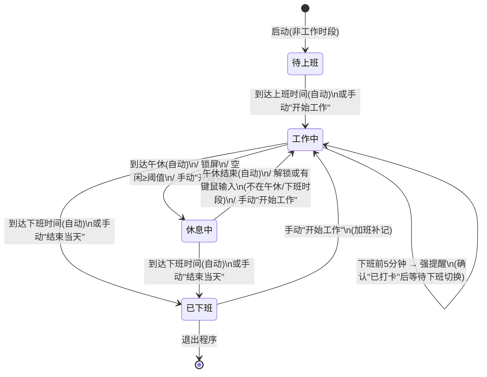

# WorkAlarmClock 工作日记桌宠 — 产品需求文档（PRD）

| 项目信息 | 内容 |
|---|---|
| 文档语言 | 简体中文 |
| 技术栈 | C# / .NET 10（net10.0-windows）+ WPF，**零第三方 NuGet 依赖、纯代码实现** |
| 项目名 | WorkAlarmClock（桌面悬浮电子闹钟桌宠 + 工作日记） |
| 文档版本 | v1.0（简单 PRD） |
| 目标用户 | 中文上班族，个人电脑自用，非企业级部署 |

## 0. 原始需求复述

> "帮我开发一个工作日记，我已经创建一个 wpf 项目，项目为一个桌面悬浮电子闹钟桌宠，记录我工作时间和休息时间，并且下班前半小时自动提醒写工作汇报，并生成工作汇报模板，下班前 5 分钟强提醒我打卡。另外你需要完善功能和我商量后执行。"

与用户已确认的关键决策（**严格遵守，不得变更**）：

1. **记录方式**：自动作息（可配置上下班/午休时间）为主 + 桌宠上手动一键切换/纠正 + 锁屏与空闲检测（锁屏或长时间无键鼠操作自动判定为休息，回来自动恢复工作）。
2. **桌宠形态**：卡通角色 + 时钟气泡。悬浮小角色，显示当前时间与已工作时长，工作/休息/提醒时切换表情与动作，可拖动、可贴边隐藏。
3. **汇报产出**：自动生成 Markdown 文件落盘 + 一键复制到剪贴板（方便贴到企业微信/邮件）。
4. **技术方案**：零第三方依赖。MVVM 自写轻量基类（ObservableObject / RelayCommand）；托盘用框架自带的 `System.Windows.Forms.NotifyIcon`；空闲检测用 `GetLastInputInfo` P/Invoke；锁屏检测用 `Microsoft.Win32.SystemEvents.SessionSwitch`；持久化用 `System.Text.Json`；卡通形象用 XAML 矢量图形（Path/Ellipse/Storyboard 动画）绘制而非图片资源。

## 1. 产品目标

**一句话**：一个悬浮在桌面上的电子闹钟桌宠，自动记好你的一天，准点提醒你别忘记，下班前一键把日报写完。

**三条核心价值**：

1. **自动记录，无需操心**：基于作息表 + 锁屏/空闲检测自动累计工作与休息时长，用户不点任何按钮也能得到完整的一天记录。
2. **关键时刻，绝不遗漏**：下班前 30 分钟温和提醒写日报、下班前 5 分钟强提醒打卡，两条提醒链路独立可配置。
3. **一键成稿，直接可发**：白天随手记的"我在做什么"自动成为日报素材，一键生成 Markdown 并复制到剪贴板，贴进企业微信/邮件即发。

## 2. 目标用户与使用场景

**目标用户**：使用 Windows 个人办公电脑的中文上班族（本项目即开发者本人，单机自用）。

**典型场景（一天）**：

| 时间 | 场景 | 产品行为 |
|---|---|---|
| 09:00 前 | 开机，桌宠悬浮在屏幕角落 | 显示当前时间，状态"待上班" |
| 09:00–12:00 | 专注写代码、开会 | 到点自动进入"工作中"，随做随往"今日事项"里添一条 |
| 10:30 | 去倒水，电脑锁屏 10 分钟 | 自动判定为休息，不计入工作时长；回来解锁自动恢复工作 |
| 12:00–13:00 | 午休 | 自动进入"午休中"，气泡显示午休倒计时 |
| 17:30 | — | 弱提醒弹出："还有 30 分钟下班，该写日报啦"，点击立即生成日报并复制 |
| 17:55 | — | 强提醒置顶弹窗："请立即打卡"，需手动确认 |
| 18:00 后 | 下班 | 状态"已下班"，日报文件已落盘到文档目录 |

## 3. 核心概念与术语定义

| 术语 | 定义 |
|---|---|
| **工作时间** | 当天处于"工作中"状态的累计净时长（分钟级，扣除自动/手动进入的休息时段）。默认策略：锁屏与空闲时段**不计入**工作时间。 |
| **休息时间** | 当天处于"休息中"状态的累计时长，包含午休、锁屏/空闲自动休息、手动休息三类来源。 |
| **锁屏** | 通过 `SystemEvents.SessionSwitch`（SessionLock / SessionUnlock 等事件）检测到系统锁定或会话离开。锁屏即视为休息。 |
| **空闲** | 通过 `GetLastInputInfo` P/Invoke 轮询到的"最后一次键鼠输入"距今超过可配置阈值（默认 5 分钟）即判定为空闲，自动进入休息。 |
| **弱提醒** | 非模态、不打断工作的提醒：桌宠气泡 + 可选提示音 + 托盘通知，支持"立即处理 / 稍后提醒 / 忽略"。用于下班前 30 分钟写日报提醒。 |
| **强提醒** | 模态置顶弹窗，需手动确认才消失，可配置是否允许忽略及重复策略。用于下班前 5 分钟打卡提醒。 |
| **汇报模板** | 用户可自定义的 Markdown 模板，内含占位符（如 `{{WorkDuration}}`），生成日报时以当日实际数据填充。 |
| **补记** | 用户通过手动切换状态或编辑当日记录，对自动判定结果进行修正的机制。 |
| **今日事项** | 用户当天随时添加的带时间戳的工作条目，是日报"工作事项列表"的数据来源。 |

## 4. 用户故事

1. 作为上班族，我希望**到达上班时间后桌宠自动开始计时**，以便我不需要每天手动点"开始工作"。
2. 作为上班族，我希望**锁屏或长时间无操作时自动判定为休息、回来后自动恢复工作**，以便去倒水、开会不在座位时的时间记录依然准确。
3. 作为上班族，我希望在桌宠上**一键切换"工作中/休息中"或结束当天**，以便自动判定出错时我能手动纠正。
4. 作为上班族，我希望**随时添加带时间戳的"我在做什么"事项**，以便下班写日报时不用回忆今天做了什么。
5. 作为上班族，我希望**下班前 30 分钟收到温和提醒并一键生成日报**，以便从容完成汇报而不被最后几分钟搞得手忙脚乱。
6. 作为上班族，我希望**生成的日报自动保存为 Markdown 文件并可一键复制到剪贴板**，以便直接贴到企业微信或邮件里发送。
7. 作为上班族，我希望**下班前 5 分钟收到无法错过、需手动确认的强提醒**，以便绝不忘记打卡。
8. 作为上班族，我希望**桌宠显示当前时间、今日已工作时长和当前状态**，以便抬眼即知今天进度。
9. 作为上班族，我希望**桌宠可拖动、贴边收纳，工作/休息/提醒时有不同表情和动作**，以便它既实用又不遮挡工作。
10. 作为上班族，我希望**自定义作息表（上下班、午休、工作日）和提醒提前量**，以便适配弹性工作或节假日调休。
11. 作为上班族，我希望**通过托盘图标查看状态和快捷操作（切换状态/生成汇报/设置）**，以便桌宠收起来后功能照常可用。
12. 作为上班族，我希望**看到今日/本周工作时长统计**，以便了解自己的工作节奏。

## 5. 需求池

优先级定义：**P0 = Must have**（首版必须交付）；**P1 = Should have**（首版尽量交付）；**P2 = Nice to have**（后续迭代）。

| ID | 需求描述 | 优先级 | 验收标准 |
|---|---|---|---|
| R-01 | **悬浮桌宠窗口**：置顶（Topmost）、无边框、透明背景、可鼠标拖动、支持左右边缘/四角吸附，靠边后收缩为窄条半隐藏；双击展开主面板 | P0 | 拖动释放后 30px 内自动吸附边缘并收缩为窄条；窄条悬停/点击可展开；双击桌宠打开主面板；始终置顶不被其他窗口遮挡 |
| R-02 | **实时时钟与状态显示**：桌宠气泡显示当前时间（HH:mm）、今日已工作时长（HH:mm）、当前状态（待上班/工作中/休息中/午休中/已下班） | P0 | 时间每秒刷新；时长每分钟累计刷新；状态切换 ≤1 秒内反映到 UI 与托盘 tooltip |
| R-03 | **桌宠表情与动作**：XAML 矢量卡通角色，工作中/休息中/提醒中切换不同表情与 Storyboard 动画 | P0 | 至少 4 套表情（工作、休息、弱提醒、强提醒）；状态切换时 1 秒内播放对应动画；动画不阻塞 UI 线程 |
| R-04 | **作息时间表配置**：上班/下班时间、午休起止，默认 09:00–18:00、午休 12:00–13:00；每星期几为工作日可勾选 | P0 | 配置保存后重启仍生效；非工作日不自动开始计时、不触发提醒；午休可整体关闭 |
| R-05 | **自动状态机**：到上班时间自动"开始工作"，到午休自动"午休"，午休结束自动恢复工作，到下班时间自动"已下班" | P0 | 4 个时间点到点 ≤10 秒内自动切换；跨过时间点的启动（如 10:00 启动程序）也能正确落到"工作中"；手动结束后当天不再自动切回工作 |
| R-06 | **锁屏检测**：`SystemEvents.SessionSwitch` 检测锁屏/解锁，锁屏即进入休息，解锁后按策略恢复 | P0 | 锁屏 ≤5 秒内状态变"休息中"并暂停工作计时；解锁后按恢复策略处理（见 R-07） |
| R-07 | **空闲检测与恢复策略**：`GetLastInputInfo` 轮询，空闲阈值可配置（默认 5 分钟）；回来后自动恢复工作；**默认策略：锁屏与空闲时段不计入工作时长** | P0 | 空闲达到阈值自动切"休息中"；回来（有键鼠输入且不在午休/下班时段）≤10 秒自动恢复"工作中"并气泡提示"已恢复工作，点此纠正"；策略可在设置中关闭（即空闲仍计入工作时长） |
| R-08 | **手动切换与补记**：托盘菜单与主面板提供"开始工作 / 开始休息 / 结束当天" | P0 | 手动操作立即生效并优先于自动状态机（手动结束后不再自动恢复）；"结束当天"后仍可手动重新开始（加班补记） |
| R-09 | **下班前 30 分钟弱提醒（写日报）**：桌宠气泡 + 可选提示音 + 托盘通知，提供"立即生成 / 稍后提醒（10 分钟）/ 忽略" | P0 | 提前量可配置（默认 30 分钟）；到点必弹一次；点"立即生成"直接产出日报并复制；"稍后"到点再次弹出；当天已生成过日报则只通知不弹气泡 |
| R-10 | **下班前 5 分钟强提醒（打卡）**：模态置顶全屏遮罩弹窗 + 提示音，需手动确认"已打卡"关闭；可配置是否允许忽略、重复提醒策略（默认每 60 秒重复、最多 3 次） | P0 | 提前量可配置（默认 5 分钟）；弹窗始终置顶且不可被遮挡；未确认时按策略重复；"允许忽略"开关默认**关闭**（即不允许忽略，必须确认） |
| R-11 | **今日工作日志（事项）**：主面板可随时添加"我在做什么"条目，自动打时间戳，可删除；作为日报素材 | P0 | 添加后 ≤1 秒出现在列表；时间戳精确到分钟；条目写入当日数据文件，重启不丢 |
| R-12 | **工作汇报生成**：按模板生成 Markdown 日报，字段含：日期、今日工作时长、休息时长、午休时间段、工作事项列表（来自今日事项）、明日计划、风险与待办；支持自定义模板占位符 | P0 | 生成的 .md 内容与当日数据一致；占位符全部被正确替换；同日重复生成覆盖写入并自动保留上一版为 .bak |
| R-13 | **汇报落盘与一键复制**：日报保存到可配置目录，默认 `文档/WorkAlarmClock/Reports/YYYY-MM-DD.md`；预览面板提供"复制到剪贴板" | P0 | 目录不存在自动创建；复制后剪贴板内容与文件一致；落盘/复制成功有气泡反馈并可选打开目录 |
| R-14 | **数据持久化**：每日记录（状态切换流水、工作/休息时长、事项、配置）以 JSON 存储，默认 `%LOCALAPPDATA%/WorkAlarmClock/`；启动时加载当天数据，跨天自动归档前一天 | P0 | 强杀进程后重启时长累计无显著丢失（分钟级）；跨天启动自动读取/归档，不混淆两天数据；仅用 System.Text.Json |
| R-15 | **系统托盘**：NotifyIcon 显示状态图标与 tooltip（当前时间 + 已工作时长），右键菜单：打开主面板 / 开始工作 / 开始休息 / 结束当天 / 生成汇报 / 设置 / 退出 | P0 | 全部菜单项可用且与桌宠状态一致；关闭主面板程序不退出（驻留托盘）；托盘双击打开主面板 |
| R-16 | **设置面板**：作息时间、工作日、弱/强提醒开关与提前量、空闲阈值、锁屏即休息开关、空闲是否计入工时、声音开关、桌宠透明度、汇报目录、模板编辑入口、开机自启开关 | P0 | 所有设置即改即存（或保存后生效）；非法输入（如下班早于上班）有校验提示；设置项均有默认值 |
| R-17 | **零第三方依赖技术约束**（非功能）：不引入任何 NuGet 包；自写 ObservableObject/RelayCommand；托盘用 WinForms NotifyIcon；P/Invoke 用 GetLastInputInfo；锁屏用 SystemEvents；持久化用 System.Text.Json；桌宠为 XAML 矢量图形 | P0 | `dotnet build` 后项目依赖树中无任何第三方 PackageReference；全部功能按此约束实现 |
| R-18 | **今日/本周统计概览**：主面板或统计页展示今日、本周（工作日累计）工作时长与休息时长 | P1 | 周统计按工作日配置聚合；数据来自每日 JSON，数值与记录一致 |
| R-19 | **日报预览面板**：生成前/后可预览渲染效果，编辑"明日计划/风险与待办"再保存 | P1 | 预览与落盘文件内容一致；可编辑后重新生成 |
| R-20 | **开机自启动**：注册表 `HKCU\...\Run` 写入/删除自启项，不引入 NuGet | P2 | 开关切换后注册表项同步增删；默认**关闭** |
| R-21 | **界面深浅色/透明度微调、更多桌宠皮肤** | P2 | 不影响首版功能 |

## 6. UI 设计描述（文字 + 线框）

### 6.1 桌宠悬浮窗（默认约 170×120，无标题栏）

- 结构：**卡通角色（左/下）+ 时钟气泡（右/上）**，气泡内两行：时间（大字号）与"已工作 HH:MM"（小字号）；角色脚下一枚状态圆点（工作中绿 / 休息中黄 / 已下班灰 / 提醒橙红闪烁）。
- 状态表情：工作中（专注+敲键盘动作）、休息中（闭眼+zZ）、午休（吃饭动作）、弱提醒（举牌"日报"）、强提醒（跳起来+红叹号）。
- 交互：左键拖动 → 松手后距屏幕左右边缘或四角 ≤30px 自动吸附，收缩为 4px 窄条（半透明，悬停展开）；双击 → 打开主面板；右键 → 快捷菜单（同托盘菜单子集）；气泡显示最近一条提醒/恢复提示，8 秒自动淡出。

```
   悬浮态                                  贴边收缩态
 ┌─────────────────┐                    ┌┤
 │  ╭───────────╮  │                    ││ ← 4px 窄条
 │  │  09:41    │  │   ← 时钟气泡        └┤   悬停展开
 │  │ 已工作00:41│  │                      '
 │  ╰───────────╯  │
 │    (◕‿◕)        │  ← 卡通角色(矢量)
 │     ● 工作中    │  ← 状态圆点
 └─────────────────┘
  气泡: "已恢复工作, 点此纠正"
```

### 6.2 主面板（双击桌宠展开，常规带标题栏窗口，约 420×520）

- 顶栏：状态点 + 状态文字、当前时间、今日工作/休息/午休三个时长胶囊。
- 操作行：`[开始休息] [开始工作] [结束当天]`（按当前状态禁用相应项）。
- 今日事项列表：时间戳 + 文本 + 删除按钮；底部输入框 + `[添加]`（Enter 提交）。
- 底部按钮：`[生成工作汇报] [日报预览] [统计] [设置]`。

```
┌─ WorkAlarmClock ────────────────────┐
│ ● 工作中   09:41:23                 │
│ [工作 00:41] [休息 00:12] [午休 --:--]│
│ [开始休息] [开始工作] [结束当天]      │
├─────────────────────────────────────┤
│ 今日事项                             │
│ 09:15  需求评审              [删除]  │
│ 10:02  编写PRD               [删除]  │
│ [ 输入我在做什么…            ] [添加] │
├─────────────────────────────────────┤
│ [生成工作汇报] [日报预览] [统计] [设置]│
└─────────────────────────────────────┘
```

### 6.3 提醒弹窗（两种形态）

**弱提醒（写日报，非模态，贴桌宠弹出）**：

```
 ╭─ ⏰ 还有 30 分钟下班 ────────────╮
 │ 今天的工作还没写进日报哦～        │
 │ [立即生成]  [稍后提醒]  [忽略]   │
 ╰─────────────────────────────────╯
```

**强提醒（打卡，模态置顶 + 全屏半透明遮罩 + 提示音）**：

```
        ┌───────────────────────────────────┐
        │  ⚠️  下班前 5 分钟 · 请立即打卡      │
        │                                    │
        │   当前时间 17:55                   │
        │   今日工作 07:42 · 日报 已生成✔    │
        │                                    │
        │   [ 已打卡，确认 ]                 │
        │   （默认不可忽略；未确认 60 秒后再响）│
        └───────────────────────────────────┘
```

### 6.4 设置面板（独立窗口，分区/Tab：作息 · 提醒 · 检测 · 外观 · 存储）

```
┌─ 设置 ─────────────────────────────────────┐
│ [作息] [提醒] [检测] [外观] [存储]           │
│ 上班 [09:00]  下班 [18:00]                  │
│ 午休 [12:00]–[13:00]  ☑ 启用午休            │
│ 工作日 ☑一 ☑二 ☑三 ☑四 ☑五 ☐六 ☐日         │
│ ── 提醒 ──                                   │
│ 弱提醒提前 [30] 分钟  ☑ 启用    ☑ 声音       │
│ 强提醒提前 [5] 分钟   ☑ 启用    ☐ 允许忽略   │
│ ── 检测 ──                                   │
│ ☑ 锁屏即休息   空闲阈值 [5] 分钟            │
│ ☐ 空闲也计入工作时长                        │
│ ── 外观/存储 ──                              │
│ 桌宠透明度 [——●——] 80%                     │
│ 汇报目录 [文档\WorkAlarmClock\Reports] [浏览]│
│ [编辑日报模板…]   ☐ 开机自启(注册表)        │
│                [保存]  [取消]               │
└─────────────────────────────────────────────┘
```

### 6.5 日报预览面板（左侧原文预览 / 右侧元信息与操作）

```
┌─ 工作汇报 · 2026-XX-XX ────────────────────────┐
│ ┌─ 预览 ────────────────┐  保存到:              │
│ │ # 工作日报 2026-XX-XX │  文档\...\2026-XX-XX.md│
│ │ - 今日工作：07:42     │  ── 可编辑区 ──        │
│ │ - 休息：00:35         │  明日计划: [______]    │
│ │   (含午休 12:00-13:00)│  风险与待办: [______]  │
│ │ ## 今日事项           │                       │
│ │ 1. 09:15 需求评审     │  [重新生成] [打开目录] │
│ │ 2. 10:02 编写PRD      │  [复制到剪贴板] [关闭] │
│ └───────────────────────┘                       │
└────────────────────────────────────────────────┘
```

**默认日报模板**（占位符可被用户自定义模板替换）：

```markdown
# 工作日报 {{Date}}

- 今日工作时长：{{WorkDuration}}
- 休息时长：{{RestDuration}}（含午休 {{LunchRange}}）

## 今日事项
{{Tasks}}

## 明日计划
{{TomorrowPlan}}

## 风险与待办
{{Risks}}
```

内置占位符：`{{Date}}`、`{{WorkDuration}}`、`{{RestDuration}}`、`{{LunchRange}}`、`{{Tasks}}`、`{{TomorrowPlan}}`、`{{Risks}}`。其中 `{{Tasks}}` 展开为带时间戳的编号列表；`{{TomorrowPlan}}` / `{{Risks}}` 为生成时可在预览面板填写的内容（默认 `-`）。

## 7. 状态流转说明

**五种主状态**：`待上班`、`工作中`、`休息中`（来源：午休 / 锁屏 / 空闲 / 手动，气泡注明来源）、`已下班`；`弱提醒`、`强提醒`为叠加在其上的提醒子状态。

**计时规则**：工作时长只在"工作中"状态累计；休息时长只在"休息中"累计；"待上班/已下班"两者都不累计。手动操作优先级 > 自动作息 > 检测类切换；"结束当天"为终态锁，当天不再自动恢复工作（可手动重开用于加班补记）。



说明：非工作日启动时停留在"待上班"，不自动进入"工作中"。

## 8. 数据与文件设计（给开发的约束性说明）

- **每日数据文件**：`%LOCALAPPDATA%/WorkAlarmClock/data/YYYY-MM-DD.json`，内容至少含：状态切换流水（时间 + 前后状态 + 触发来源 auto/schedule/manual/lock/idle）、事项列表（时间戳 + 文本）、汇总时长、日报生成记录。序列化用 `System.Text.Json`。
- **配置文件**：`%LOCALAPPDATA%/WorkAlarmClock/settings.json`（作息、提醒、检测、外观、汇报目录、自定义模板文本）。
- **日报文件**：默认 `文档/WorkAlarmClock/Reports/YYYY-MM-DD.md`，重复生成覆盖并保留 `.bak`。
- 跨天启动时按日期归档，同一天重启程序基于流水重算时长，保证幂等。

## 9. 待确认问题（附默认建议，未提出异议即按默认执行）

1. **锁屏/空闲时段是否计入工作时长？**
   建议：默认**不计入**（休息时长反而更真实）；设置中提供"空闲也计入工作时长"开关（R-07），锁屏始终计入休息。
2. **回来后自动恢复工作，还是弹窗询问？**
   建议：默认**自动恢复 + 气泡提示"已恢复工作，点此纠正"**（减少打断）；不做强制确认弹窗。
3. **强提醒是否允许忽略？重复几次？**
   建议：默认**不允许忽略**，必须点"已打卡"确认；未确认每 60 秒重复提示音与窗口闪烁，最多 3 次；设置中可打开"允许忽略"（需明确接受忘打卡风险）。
4. **非工作日/请假的行文案？**
   建议：默认非工作日**完全静默**（不自动计时、不提醒），但手动"开始工作"仍可记录（用于加班）；暂不做请假管理。
5. **同日重复生成日报的覆盖策略？**
   建议：默认**覆盖写入 + 自动保留上一版为 `.bak`**，避免误删已编辑内容；不做多版本历史。

---
*本文档为简单 PRD，聚焦问题定义与需求池；技术详细设计由架构/开发阶段产出。*
